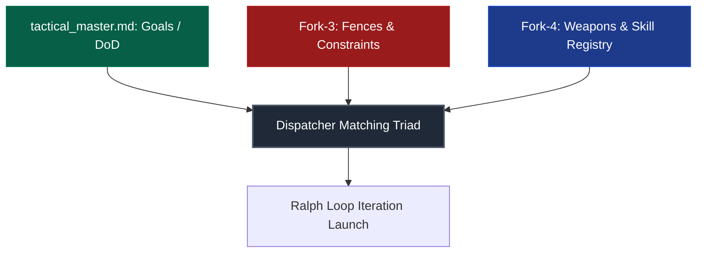
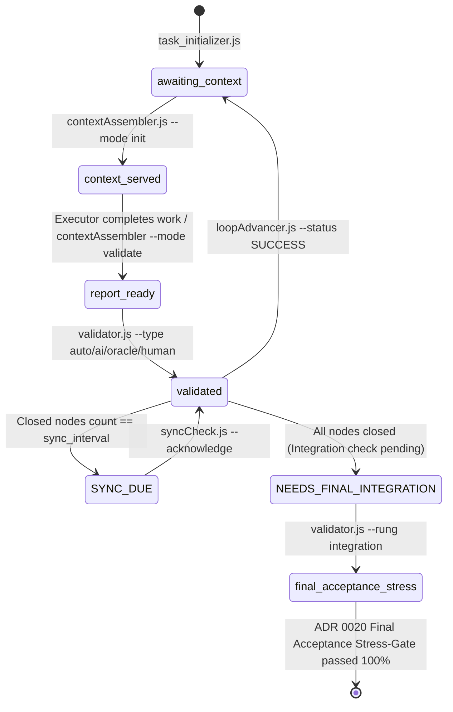

# Harness Protocol: The Cybernetic Control Frame for Autonomous AI Agents

[](https://opensource.org/licenses/Apache-2.0)
[](Scripts/run_all_tests.js)
[](#integrity-gate)
[-blue)](#langgraph-core)
[](#evidence-ladder)
[](#adr-catalog)


[Русская версия / Russian Version](README.ru.md)

Welcome to the **Harness Protocol** specification and reference implementation repository. This repository defines and implements a strict, sandboxed cybernetic control framework governing how autonomous AI agents interface with local file systems, compilers, execution environments, game engines, and test suites.

---

## 1. Executive Summary & Core Philosophy

In traditional AI software engineering, LLMs are granted unrestricted shell execution and unconstrained file-writing privileges. This lack of boundaries inevitably leads to high cognitive variance, context bloat, hallucinated test passes, silent structural regressions, and security risks. Under continuous execution, probabilistic models accumulate compound errors, culminating in infinite regression loops or phantom completions.

The Harness Protocol resolves this by treating the AI agent not as an unconstrained developer, but as a dual-component cybernetic system:

$$\text{Agent} = \text{Model} + \text{Harness}$$

* **The Model (LLM)** represents the core probabilistic reasoning, hypothesis generation, and decision-making engine.
* **The Harness** provides deterministic sandboxing, enforces immutable state gates, verifies executable evidence through strict oracles, and validates compliance through independent adversarial judges.

```
                  ┌────────────────────────────────────────┐
                  │                 MODEL                  │
                  │   Reasoning, Planning, Code Writing    │
                  └───────────────────┬────────────────────┘
                                      │
                                  Composes
                                      │
                                      ▼
                  ┌────────────────────────────────────────┐
                  │                HARNESS                 │
                  │  Restricts environment, checks state,  │
                  │  runs compilers/tests, invokes judges  │
                  └───────────────────┬────────────────────┘
                                      │
                               Validates & Enforces
                                      │
                                      ▼
                              [Working Codebase]
```

### The System Core Goals
1. **Safety & Sandboxing:** A cryptographic and logical guarantee that an AI agent cannot damage host systems, access unauthorized paths, leak secrets, or run destructive commands.
2. **Determinism:** Wrapping probabilistic text-based models in a deterministic runtime context (AST linters, compilers, strict state machines, and evidence rungs).
3. **The Ratchet Principle:** Ensuring that every error or regression committed by the AI is analyzed, cataloged, and guarded against by inserting a permanent test, fence, or rule into the repository.
4. **Executable Truth Over Diff-Reading:** Prohibiting completion based purely on an LLM reading code diffs. A task is verified through runnable oracles, verified receipts, and adversarial cross-family audits.

---

## 2. Core Architecture & The Cybernetic Contour

At the start of any work cycle, the agent is constrained by the **Matching Triad** of resources:



1. **Task Master (`tactical_master.md`):** The definitive contract defining objectives, deliverables, and Definition of Done (DoD).
2. **Fences (Constraints / Fork-3):** Hard, non-negotiable boundaries defining what the model is strictly forbidden to do. Attempted violations immediately trip execution fences and trigger reflection.
3. **Weapons (Tools & Skills / Fork-4):** Recommended tools, specialized scripts, and MCP servers. The agent may use external CLI commands only if permitted by Fork-3, and must record newly proven capabilities back to Fork-4.

### Strict Agent Operational Laws
* **Session Isolation:** Subagents are spawned with fresh, clean session histories. Sharing accumulated transcripts across tasks is forbidden.
* **Pre-Context Assembly:** Context is compiled and injected into the first turn of the subagent via `contextAssembler.js`.
* **External Auditing:** An executor subagent must never evaluate its own result. All evaluations pass through a third party (compiler or independent AI judge).
* **Absolute Ban on Skipping Steps (No Skip Law):** If a process fails or throws an error, the agent MUST stop, add a troubleshooting node, resolve the root cause, and only then resume. Skipping broken steps is considered sabotage.
* **Anti-Hallucination Law (No Agent Simulation):** It is strictly forbidden to emulate, fake, or hallucinate responses from other agents, judges, or CLI tools. Real execution and real errors must be handled.
* **Model Fallback Protocol:** When invoking AI models, all available models of the current tier must be attempted. If none succeed, the system falls back exactly one tier lower. Surrendering after a single failure is forbidden.
* **Mandatory Compilation Checks:** It is forbidden to complete code implementation without inspecting compiler and test logs. All compilation issues must be fixed immediately.

### Brain Partitioning by `artifact_kind`
The Harness splits execution strategies based on the kind of deliverable:
* **`code` Nodes:** Executed by an IDE agent directly inside the working directory. Evidence passed to the AI judge consists of `git diff HEAD`, verified test logs, and compiler receipts.
* **`text` Nodes:** Executed autonomously by the `strategyEngine` script. Evidence consists of the raw contents of deliverables, with step results persisted to `op_*.json` disk contracts.

---

## <a id="langgraph-core"></a>3. The LangGraph StateGraph Core & Gated State Machine

Harness Protocol v3.0 utilizes **LangGraph.js (`@langchain/langgraph`)** as its deterministic hierarchical execution runtime.

```
┌─────────────────────────────────────────────────────────────────────────────┐
│ TaskOrchestratorGraph (thread_id = taskId)                                 │
│                                                                             │
│  [ReadRoadmap] ──► [ScaleGateCheck] ──► [DriftGuardCheck]                   │
│                                                │                            │
│                                                ▼                            │
│                                  [DynamicDecompositionGate]                 │
│                                                │ (ADR 0021 Fracturing)      │
│                                                ▼                            │
│                                     [RalphLoopSubgraph]                     │
│                                                │                            │
│                                                ▼                            │
│                                      [CheckTaskStatus]                      │
│                                      ┌─────────┴─────────┐                  │
│                                      ▼                   ▼                  │
│                                 [NextNode]   [FinalAcceptanceStressGate]    │
│                                                          │ (ADR 0020)       │
│                                                          ▼                  │
│                                                    [TaskComplete]           │
└─────────────────────────────────────────────────────────────────────────────┘
```

### The 7 Pluggable Strategy Subgraphs (`Scripts/graph/strategies/`)
Every tactical node is assigned an optimal execution strategy based on predictability and task atomicity:

| Strategy | Engine Script | Topology & Role | Disk Contract |
| :--- | :--- | :--- | :--- |
| **1. Prompt Chaining** | `chaining.js` | Sequential linear step-by-step DoD satisfaction | `op_memory.json` |
| **2. Routing** | `routing.js` | Domain classification (`ui`, `audio`, `logic`) & specialized worker dispatch | `op_route.json` |
| **3. Parallelization** | `parallelization.js` | Sharded concurrent execution with collator aggregation | `op_collated.json` |
| **4. Orchestrator-Workers** | `orchestrator.js` | Dynamic task decomposition and dependency resolution across workers | `op_plan.json` |
| **5. Map-Reduce** | `mapReduce.js` | Massive dataset chunking, parallel mapping, and hierarchical reduction | `op_reduce_final.json` |
| **6. LATM (Tool Maker)** | `latm.js` | Runtime utility synthesis, AST syntax guard validation, and sandbox run | `op_tool_output.json` |
| **7. Evaluator-Optimizer** | `evaluatorOptimizer.js`| Generator-critic iterative feedback loop until threshold is met | `op_feedback_loop.json` |

### Deterministic State Machine Progression
Task advancement is recorded in `.harness_state.json` and mirrored to `.harness_wal.jsonl`:



### Deterministic State Locks (Gates)
* **`contextAssembler --validate`:** Blocked unless state is `context_served`.
* **`contextAssembler --init/step`:** Blocked unless state is `awaiting_context` and `sync_due` is cleared.
* **`validator.js`:** Blocked unless `validation_report.md` exists and contains substantive `## SELF-REVIEW`.
* **`loopAdvancer.js`:** Blocked unless the active node has passed all mandatory deterministic floor rungs.
* **`Final Integration Gate`:** Blocked unless a fresh, untampered full-suite integration receipt exists.

---

## <a id="evidence-ladder"></a>4. Evidence Ladder & The Oracle Floor (Levers 1′–6)

Quality does not come from reading diffs. It comes from **executable truth** and **adversarial verification**.

### The Core Rule (Lever 1′)
> Every node is verified by the **STRONGEST oracle** its artifact admits. The deterministic floor is mandatory and cannot be lowered — an agent or human may only ADD rigor. The LLM judge covers ONLY what no oracle can verify (intent match, design soundness).

```
                      ┌──────────────────────────────────────┐
                      │          HUMAN ACCEPTANCE            │ (Subjective feel / GDD match)
                      ├──────────────────────────────────────┤
                      │          ADVERSARIAL AI JUDGE        │ (Design, security, edge cases)
                      ├──────────────────────────────────────┤
                      │       MANDATORY ORACLE FLOOR         │ (Deterministic execution)
                      │  compile + tests + console + security │
                      └──────────────────────────────────────┘
```

### Artifact Classes & Mandatory Rungs
Set via `roadmapEdit.js <dir> add-node ... --class <class>`:

| Artifact Class | Mandatory Floor (Deterministic Rungs) | Role of LLM Judge |
| :--- | :--- | :--- |
| **`code.testable`** | `compile` + `tests` + `security` | Intent, design, edge cases only |
| **`code.behavioral`** | `compile` + `console_clean` + `tests` + `security` | Behavioral observation + subjective UX |
| **`text`** | None deterministic | Primary adversarial evaluation |

### Evidence Receipts & Source Fingerprinting
1. **Immutable Receipts (`evidence_receipts.json`):** Each rung execution records an immutable cryptographic receipt. Bumping the node iteration immediately invalidates stale receipts.
2. **Cryptographic Source Snapshots (`sourceEvidence.js`):** The validator fingerprints source bytes, timestamps, and directory structures before and after execution. Rewriting, reverting, or adding temporary dependencies during a check immediately fails validation.
3. **Automated Security Floor (`securityScan.js`):** Auto-scans all modified deliverables for private keys, tokens, hardcoded credentials, and dangerous constructs (`eval`, disabled TLS).
4. **Turnkey Oracle Suggestions (`oracleSuggest.js`):** Auto-detects the project stack (`node`, `dotnet`, `unity`, `rust`, `python`) and emits exact commands to satisfy the floor.

---

## <a id="integrity-gate"></a>5. Universal Cross-Validation, Adversarial Judges & Rubric


### 1. The F5 Integrity Gate & Self-Validation Ban
* **The Self-Validation Ban:** An AI agent executing a task **never** validates its own result in the active session.
* **Cross-Family Prioritization:** The selection algorithm (`judgeSelector.js`) prioritizes judges from a different model family than the worker (e.g., Claude worker $\rightarrow$ Gemini/GPT judge).
* **Subagent-Fallback Gating:** If external CLI judges are offline, the validator outputs the task to `ai_judge_task.md` and requests a fresh-session IDE subagent (`NEEDS_SUBAGENT_JUDGE`).

### 2. Weighted Adversarial Judge Rubric (`rubric.js`)
The AI judge evaluates work through a red-team lens with a presumption of suspicion, scoring 4 dimensions:

$$\text{Composite Score} = 0.30 \times \text{Func} + 0.25 \times \text{Qual} + 0.25 \times \text{Sec} + 0.20 \times \text{Edge}$$

* **Hard Security Floor:** The Security score must be $\ge 5.0$.
* **Composite Threshold:** The composite weighted score must be $\ge 7.0$ (`HARNESS_RUBRIC_THRESHOLD`). Any failure downgrades a nominal `pass: true` to `FAIL`.

### 3. Criticality Level Mapping

| Level | Description | Validation Mode | Quorum Mechanics |
| :--- | :--- | :--- | :--- |
| **L0** | Trivial / Predefined code | **Deterministic Oracle Only** | Verified strictly by compilers/tests. Zero LLM tokens spent. |
| **L1** | Standard feature change | **Single Medium Judge** | Evaluated by one medium cross-family judge. |
| **L2** | High-impact deliverable | **Single Strong Judge** | Evaluated by one strong cross-family judge. |
| **L3** | System architectural invariant | **Strong Quorum** | Evaluated by two distinct cross-family judges in consensus. |

---

## 6. Memory Architecture & Token Economy

Tactical memory is organized in a three-tier hierarchy to eliminate context bloat:

```
┌────────────────────────────────────────────────────────────────────────┐
│                   L3: VECTOR WIKI & SKILL REPOSITORY                   │
│   Global knowledge base, architectural invariants, distilled skills.   │
└───────────────────────────────────▲────────────────────────────────────┘
                                    │ (Human Gate Approval)
┌───────────────────────────────────┴────────────────────────────────────┐
│                   L2: TACTICAL MEMORY (Six-File Fork)                   │
│   Long-lived task passport, active roadmap, fences, tools, work logs.  │
└───────────────────────────────────▲────────────────────────────────────┘
                                    │ (Compilation & Summary)
┌───────────────────────────────────┴────────────────────────────────────┐
│                 L1: OPERATIONAL MEMORY (Step Buffer)                  │
│   Short-lived JSON buffers (op_*.json) describing atomic steps.        │
│   Garbage-collected automatically once a node transitions to SUCCESS.   │
└────────────────────────────────────────────────────────────────────────┘
```

### The Six-File Tactical Fork Structure (L2)
All files reside in `memory/tactical/<task_id>/`:
1. **`tactical_master.md`**: Core task passport, raw specifications, and global navigation matrix.
2. **`forks/tactical_ralph_loop.md`**: One-way Markdown projection of `.harness_roadmap.json`.
3. **`forks/tactical_work_log.md`**: Contains **Warm Storage** (closed node summaries) and **Hot Storage** (last 5 iterations).
4. **`forks/tactical_constraints.md`**: Static registry of non-negotiable fences.
5. **`forks/tactical_tools_registry.md`**: Registry of approved skills and authorized CLI tools.
6. **`forks/tactical_archive_dump.md`**: **Cold Storage** containing deep execution dumps managed by `archiveNodeLog.js`.

### Measured Token Economy
* **Zero-Manual-Read:** The agent never reads raw L2 Markdown packages. `contextAssembler.js` generates compressed JSON payloads (~200–300 tokens instead of ~2,100 tokens), achieving **86% to 99% measured token savings**.
* **Drift-Guard:** Every `sync_interval` closed nodes (default: 4), `loopAdvancer` halts execution with `SYNC_DUE`. `syncCheck.js` prompts an external judge to audit the codebase against the original specification, preventing silent requirement drift.

---

## 7. Final Acceptance Stress-Gate & Dynamic Fracturing (ADR 0020 & 0021)

### ADR 0020: Total Ban on Uncontrolled Auto & Final Acceptance Stress-Gate
* **Ban on Blind `auto`:** A task cannot be declared complete simply because a unit test exited with code 0. Unit tests only verify isolated abstractions, not end-to-end integration, performance, or UI stability.
* **`finalAcceptanceStressNode`:** After all tactical roadmap nodes are closed, the task enters a mandatory stress gate:
  1. Full end-to-end stress tests and integration tests run under high concurrency or simulated chaos.
  2. Independent AI judges audit the overall implementation against `tactical_master.md`.
  3. **Remediation Loop:** Any discovered defect, runtime error, or visual flaw dynamically spawns `FIX-*` corrective nodes, returning execution to the Ralph Loop until 100% compliance is reached.

### ADR 0021: Dynamic Runtime Node Decomposition & Adaptive Fracturing
* Tactical roadmaps are living directed acyclic graphs (DAGs).
* When a node contains $\ge 3$ independent DoD criteria, uses high-breadth strategies, or uncovers hidden defects, `dynamicDecompositionGateNode` dynamically **fractures** the node into atomic sub-nodes (`NODE.1`, `NODE.2`, etc.).
* Sub-nodes execute with isolated sub-contexts and independent oracle verification before parent synthesis.

---

## 8. Studio Runtime Hardening & Engine Verification

Harness Protocol provides robust, production-grade adapters for desktop game engines and web runtimes:

### 1. Bounded Unity CLI Runner (`Scripts/unityRunner.mjs`)
A bounded, non-interactive execution adapter accepting single absolute JSON request files:
* **Preflight (`action: preflight`):** Verifies Editor paths, project versions, package manifests, and SHA-256 source digests without starting Unity.
* **Compile (`operation: compile`):** Executes batchmode C# compilation with lockfile management.
* **Tests (`operation: test`):** Executes EditMode/PlayMode suites via Unity Test Framework, parsed by `parseUnityTestResults.mjs` with strict NUnit XML schema validation.
* **Build (`operation: build`):** Executes headless WebGL and standalone builds with asset report validation.

### 2. Playwright WebGL Smoke Gate (`Scripts/webglSmoke.mjs`)
Automates headless browser testing of compiled WebGL bundles:
* Serves build artifacts on loopback with strict hash matching.
* Launches Playwright with pinned browser executables.
* Observes WebAssembly compilation, canvas initialization, and runtime state (`__harnessUnityState`).
* Sends synthetic keyboard/mouse inputs and verifies state transitions and post-reload persistence.

### 3. Headless RAF Game Loop (`Scripts/headlessLoop.mjs`)
A virtualized headless test runner for web and HTML5 canvas games:
* Stubs canvas, DOM, and `requestAnimationFrame`.
* Pumps thousands of frames headlessly to catch NaN cascades, infinite loops, and unhandled exceptions without requiring a display server.

### 4. Bounded Model Policy (`Scripts/modelPolicy.js`)
* Enforces explicit JSON authorization profiles (`HARNESS_STUDIO_PROFILE`) containing exact provider/model/role/effort tuples.
* Implements cross-process atomic token reservation ledgers with strict timeout and output limits.
* Supports deterministic offline mode (`HARNESS_OFFLINE=1`).

---

## 9. Skill Distribution & Reusable Skill Distillation

### Skill Distribution Framework (`Scripts/skillDistribution.mjs`)
Synchronizes and verifies the canonical dispatcher skill (`.agents/skills/davasko-harness-dispatcher`) across machines and local IDE installations:
* **`check`:** Compares canonical source against replica destinations using SHA-256 file manifests.
* **`plan`:** Generates an immutable deployment plan with SHA-256 integrity pins.
* **`apply`:** Validates plan digests, creates pre-mutation backups, applies verified updates, and writes a recovery journal (`recovery.json`).

### Reusable Skill Distillation (`Scripts/graph/skillDistiller.js`)
When an L3 architectural node is successfully closed, `skillDistiller.js` extracts the proven problem-solution pattern, sanitizes sensitive project data, and generates a permanent, reusable skill package in `.agents/skills/distilled-*/`.

---

## 10. Complete Script Reference & CLI Catalog

All core scripts reside in `Scripts/` and run natively under Node.js:

| Script | Command Example | Primary Function | Output Artifact |
| :--- | :--- | :--- | :--- |
| **`task_initializer.js`** | `node Scripts/task_initializer.js TACT-01 "Feature"` | Scaffolds L2 directory structure and state JSONs | `memory/tactical/TACT-01/` |
| **`roadmapEdit.js`** | `node Scripts/roadmapEdit.js <dir> add-node --id N1` | Edits roadmap nodes, DoDs, goals, and configs | `.harness_roadmap.json` |
| **`contextAssembler.js`** | `node Scripts/contextAssembler.js <dir> --mode init` | Assembles compressed context and validation reports | `validation_report.md` |
| **`validator.js`** | `node Scripts/validator.js <dir> --node N1 --type oracle` | Executes deterministic oracles and AI judges | `evidence_receipts.json` |
| **`loopAdvancer.js`** | `node Scripts/loopAdvancer.js <dir> --node N1 --status SUCCESS` | Advances Ralph Loop, checks drift, gates integration | Updated `.harness_state.json` |
| **`evidenceLadder.js`** | `node Scripts/evidenceLadder.js <dir> --node N1` | Enforces mandatory Oracle Floor for artifact classes | Floor pass / gate failure |
| **`sourceEvidence.js`** | `node Scripts/sourceEvidence.js <dir>` | Fingerprints source code bytes and detects tampering | Cryptographic hash tree |
| **`oracleSuggest.js`** | `node Scripts/oracleSuggest.js <dir> --class code.testable` | Auto-detects stack and suggests oracle commands | Recommended CLI rungs |
| **`syncCheck.js`** | `node Scripts/syncCheck.js <dir> [--acknowledge]` | Audits cumulative implementation against spec | Drift status / correction node |
| **`aiProbe.js`** | `node Scripts/aiProbe.js` | Probes CLI judge authentication via random nonces | `.harness/ai_probe.json` |
| **`unityRunner.mjs`** | `node Scripts/unityRunner.mjs <request.json>` | Bounded Unity CLI runner (compile, test, build) | Structured JSON results |
| **`webglSmoke.mjs`** | `node Scripts/webglSmoke.mjs <request.json>` | Playwright headless browser WebGL runtime test | Traces & screenshots |
| **`headlessLoop.mjs`** | `node Scripts/headlessLoop.mjs <file.html> --frames 3000` | Pumps headless rAF canvas loops to catch crashes | Clean exit / error trace |
| **`skillDistribution.mjs`**| `node Scripts/skillDistribution.mjs check --source ...` | Validates and replicates canonical dispatcher skills | Plan & recovery journal |
| **`run_all_tests.js`** | `npm test` | Master test runner executing all 18 test suites | Full test report |

---

## 11. Installation & Master Test Verification

### Prerequisites
* **Node.js** (v18.0.0 or higher, ESM supported).
* **Git** available in the system PATH.
* At least one authenticated CLI AI tool (Google Antigravity `agy`, Claude Code `claude`, or OpenAI `codex`).

### 1. Installation
```powershell
git clone <repo-url> HarnessProtocol
cd HarnessProtocol
npm install
```

### 2. Verify Authentication of External Judges
```powershell
node Scripts/aiProbe.js
```
`aiProbe` sends random nonces to all configured model binaries. Unauthenticated binaries are marked offline without quarantine; permanent failures (e.g. invalid tiers) are quarantined for 24 hours.

### 3. Run the 18-Suite Master Test Runner
```powershell
npm test
```
The master test runner verifies all 18 test suites in ~40 seconds:
```
═══════════════════════════════════════════════════════════════════════
       🛡️  HARNESS PROTOCOL — MASTER TEST RUNNER & VERIFIER           
═══════════════════════════════════════════════════════════════════════

▶️ Запуск: 1. Модули эффективности (SyntaxGuard, ContractFormalizer, SkillDistiller, Checkpointer)...
✅ [УСПЕХ] 1. Модули эффективности
▶️ Запуск: 2. Изолированные сабграфы 7 канонических стратегий LangGraph...
✅ [УСПЕХ] 2. Изолированные сабграфы 7 канонических стратегий LangGraph
▶️ Запуск: 3. Сквозной интеграционный тест LangGraph StateGraph рантайма...
✅ [УСПЕХ] 3. Сквозной интеграционный тест LangGraph StateGraph рантайма
...
▶️ Запуск: 12. Лестница доказательств: пол оракула, классы артефактов, ratchet...
✅ [УСПЕХ] 12. Лестница доказательств
▶️ Запуск: Studio hardening (test_unity_results, test_webgl_smoke, test_model_policy, etc.)...
✅ [УСПЕХ] Studio hardening suites

═══════════════════════════════════════════════════════════════════════
ИТОГИ ВСЕГО ТЕСТОВОГО СЬЮТА: 18/18 запускаемых сьютов пройдено за ~40с
Сбоев: 0 | Пропущено (опциональные): 2
═══════════════════════════════════════════════════════════════════════
```

---

## 12. Step-by-Step Execution Walkthrough (The Ralph Loop)

### Step 1: Initialize Task & Roadmap
```powershell
# 1. Scaffold L2 structure
node Scripts/task_initializer.js TACT-101 "Implement Secure Token Vault"

# 2. Add roadmap nodes with explicit artifact classes and DoDs
node Scripts/roadmapEdit.js memory/tactical/TACT-101 add-node --id NODE-01 --title "Define Vault Interface" --class code.testable --dod "Interface compiles cleanly with zero linter warnings"
node Scripts/roadmapEdit.js memory/tactical/TACT-101 add-node --id NODE-02 --title "Implement AES-GCM Vault" --class code.testable --dod "Unit tests pass 100% and passes adversarial security audit"

# 3. Build navigation matrix
node Scripts/reindexTactical.js memory/tactical/TACT-101
```

### Step 2: Execute Tactical Node with the Evidence Ladder
```powershell
# 1. Ingest context (sets state to 'context_served')
node Scripts/contextAssembler.js memory/tactical/TACT-101 --mode init

# [The AI Agent writes code in the workspace]

# 2. Execute and record mandatory Oracle Floor rungs
node Scripts/validator.js memory/tactical/TACT-101 --node NODE-01 --type oracle --rung compile --cmd "npm run build"
node Scripts/validator.js memory/tactical/TACT-101 --node NODE-01 --type oracle --rung tests --cmd "npm test"
node Scripts/validator.js memory/tactical/TACT-101 --node NODE-01 --type oracle --rung security

# 3. Assemble validation report (includes git diff and substantive ## SELF-REVIEW)
node Scripts/contextAssembler.js memory/tactical/TACT-101 --mode validate --node NODE-01

# 4. Run adversarial AI Judge evaluation
node Scripts/validator.js memory/tactical/TACT-101 --node NODE-01 --type ai

# 5. Advance loop to SUCCESS
node Scripts/loopAdvancer.js memory/tactical/TACT-101 --node NODE-01 --status SUCCESS --insight "Vault interface satisfies DoD"

# 6. Step to the next node
node Scripts/contextAssembler.js memory/tactical/TACT-101 --mode step
```

---

## <a id="adr-catalog"></a>13. Architecture Decision Records (ADR Catalog)

All architectural invariants are formally recorded in [`docs/adr/`](docs/adr/):

| ADR | Title | Summary | Status |
| :--- | :--- | :--- | :--- |
| **0001** | Isolated Context for AI Judge | Prohibits self-evaluation; mandates clean context for judges | Accepted |
| **0002** | File-Based Gated State Machine | Deterministic state progression written to disk (`.harness_state.json`) | Accepted |
| **0003** | Tri-Tier Memory Hierarchy | L1 Operational, L2 Tactical (6 forks), L3 Global Knowledge Base | Accepted |
| **0004** | L1 Disk Contracts Over Chat | Subagents exchange structured JSON files (`op_*.json`) | Accepted |
| **0005** | Periodic Drift-Guard Sync | Periodic audit preventing deviation from initial specifications | Accepted |
| **0006** | Brain Partitioning by Artifact Kind | Direct IDE execution for `code`; autonomous engine for `text` | Accepted |
| **0007** | Strict Triad of Mandatory Human Gates| Human gates strictly restricted to Wiki, Git writes, and Escalation | Accepted |
| **0008** | Scale Gating and Workflow Limits | Safety limits preventing uncontrolled concurrency and token burn | Accepted |
| **0009** | Preflight Quarantining & Cross-Family | Probing judges with nonces; prioritizing cross-provider families | Accepted |
| **0010** | Tiered Criticality & Quorum | L0 (oracle) to L3 (two-judge consensus quorum) | Accepted |
| **0011** | Marker-Based Repository Anchor | Deterministic path resolution via root marker files | Accepted |
| **0012** | Context Assembler & Token Economy | Pointwise extraction saving 86–99% of context tokens | Accepted |
| **0013** | File/Stdin Transport Isolation | Eliminating `ENAMETOOLONG` by piping payloads via files and stdin | Accepted |
| **0014** | Deterministic Security Policy | Whitelisting allowed binaries, MCP tools, and command filters | Accepted |
| **0015** | F5 Integrity Gate & Stress Testing | Automated positive/negative gate tests and boundary verification | Accepted |
| **0016** | Model Tournament & Capability Tiering| Empirical performance calibration across model families | Accepted |
| **0017** | Specialized Workflow Environments | Partitioning token budgets across multi-phase workflows | Accepted |
| **0018** | Task Archiving & Retention Lifecycle | Formal archival lifecycle moving closed dossiers to `memory/archive/` | Accepted |
| **0019** | LangGraph StateGraph & Subgraphs | Replacing legacy runners with LangGraph.js hierarchical graphs | Accepted |
| **0020** | Ban on Uncontrolled Auto & Stress Gate| Total ban on blind auto-closures; mandatory Final Acceptance Stress-Gate | Accepted |
| **0021** | Dynamic Node Decomposition (Fracturing)| Dynamic DAG fracturing of complex nodes into atomic sub-nodes | Accepted |

---

## 14. License

Harness Protocol is licensed under the **Apache License, Version 2.0**. See [`LICENSE`](LICENSE) for details.
