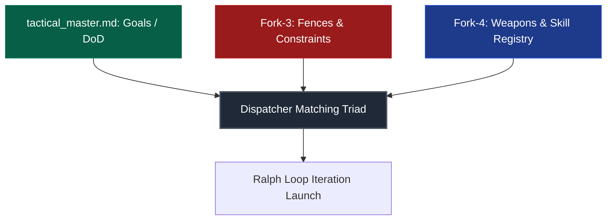
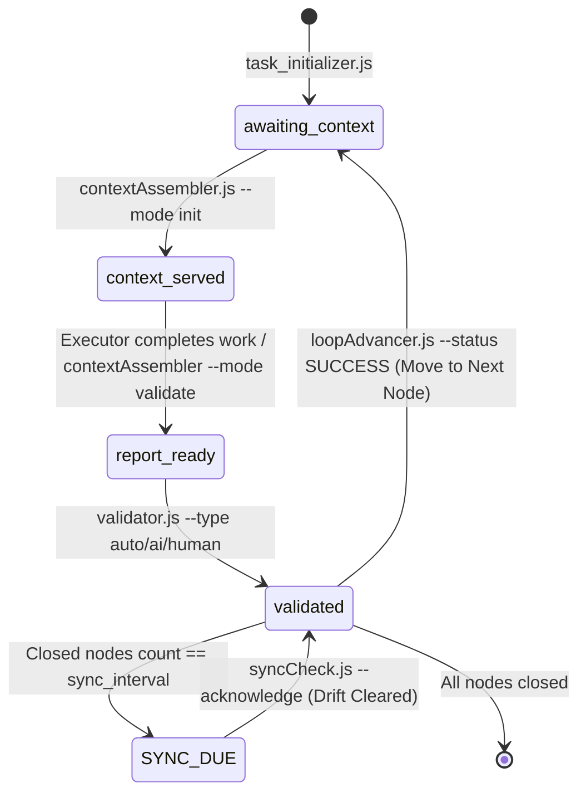
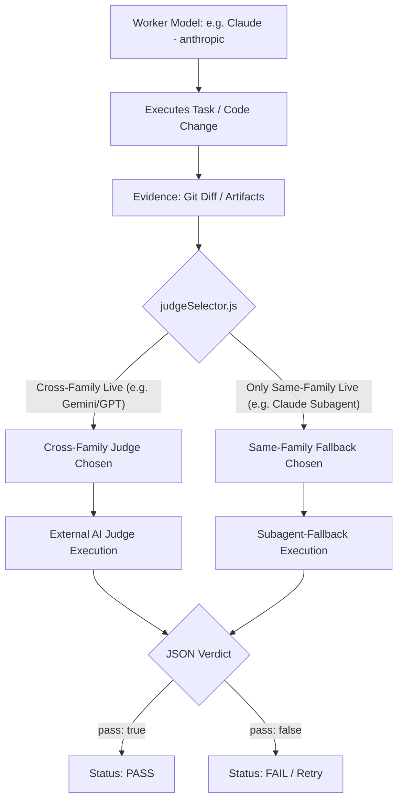
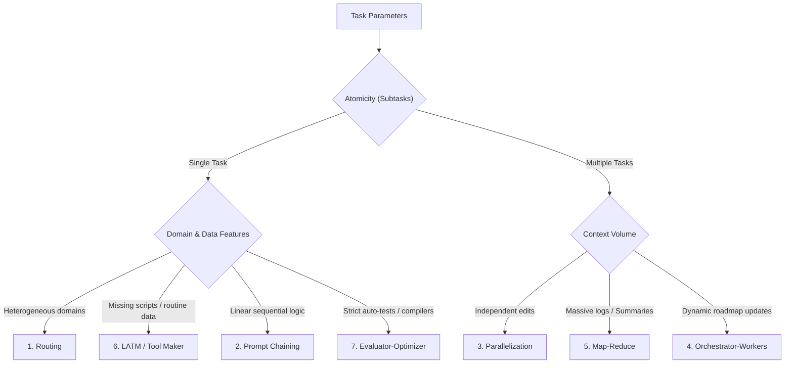

# Harness Protocol: The Cybernetic Control Frame for Autonomous AI Agents

[](https://opensource.org/licenses/Apache-2.0)
[](Scripts/smoke/run.js)
[](#5-universal-cross-validation--the-f5-integrity-gate)
[](#3-core-architecture--the-cybernetic-contour)

[Русская версия / Russian Version](README.ru.md)

Welcome to the **Harness Protocol** specification and reference implementation repository. This repository defines and implements a strict, sandboxed cybernetic control framework regulating how autonomous AI agents interface with local file systems, compilers, execution environments, and testing suites. 

---

## 1. Executive Summary & Core Philosophy

In traditional AI software engineering, LLMs are given loose shell execution and file-writing capabilities. This lack of structure leads to high cognitive variance, context bloat, codebase regressions, and security vulnerabilities. Under continuous execution, probabilistic models tend to build compound errors, culminating in infinite loop regressions or silent structural decay.

The Harness Protocol addresses this by treating the AI agent not as a standalone developer, but as a dual-component cybernetic system:

$$\text{Agent} = \text{Model} + \text{Harness}$$

* **The Model (LLM)** represents the core reasoning, hypothesis generation, and decision-making engine. It operates probabilistically.
* **The Harness** provides the sandbox environment, restricts tool execution, acts as a deterministic state gate, enforces safety, and validates results. It operates deterministically.

```
                  ┌────────────────────────────────────────┐
                  │                 MODEL                  │
                  │   Reasoning, Planning, Code Writing    │
                  └───────────────────┬────────────────────┘
                                      │
                                  Composes
                                      │
                                      ▼
                  ┌────────────────────────────────────────┐
                  │                HARNESS                 │
                  │  Restricts environment, checks state,  │
                  │  runs compilers/tests, invokes judges  │
                  └───────────────────┬────────────────────┘
                                      │
                               Validates & Enforces
                                      │
                                      ▼
                              [Working Codebase]
```

### The System Core Goals
1. **Safety & Sandboxing:** A cryptographic and logical guarantee that an AI agent cannot damage host systems, access unauthorized paths, or run malicious scripts.
2. **Determinism:** Wrapping probabilistic text-based models in a deterministic runtime context (compilers, linters, tests, and strict state transitions).
3. **The Ratchet Principle:** Ensuring that any error committed by the AI is analyzed, cataloged, and guarded against by inserting a new test or restriction, preventing future regression loops.

---

## 2. Core Architecture & The Cybernetic Contour

At the start of any work cycle, the agent is constrained by the **Matching Triad** of resources:



1. **Task Goal (Master):** The final success criterion (Definition of Done) compiled into the task passport.
2. **Fences (Constraints / Fork-3):** Hard boundaries defining what the model is strictly forbidden to do. If the model attempts to violate these, execution fails, triggering an immediate reflection cycle.
3. **Weapons (Tools & Skills / Fork-4):** Recommended tools (specialized scripts, MCP servers). The agent can use external CLI commands as long as they do not violate Fork-3 constraints, and must log any new successful tools back to Fork-4.

### Subagent Isolation Laws
* **Session Isolation:** Subagents are spawned with fresh, clean session histories. They do not share active memory logs to prevent cross-contamination.
* **Pre-Context Assembly:** Context is compiled and injected into the first turn of the subagent.
* **External Auditing:** An executor subagent must never evaluate its own result. All evaluations go through a third party (compiler or independent AI judge).

### Brain Partitioning by `artifact_kind`
The Harness splits execution strategies based on the kind of work:
* **`code` Nodes:** Executed by an IDE agent directly inside the working directory. The evidence passed to the AI judge is strictly the `git diff HEAD` payload.
* **`text` Nodes:** Executed autonomously by the `strategyEngine` script. The evidence is the raw contents of the deliverables, and the engine writes step results to `op_*.json` blobs.

---

## 3. The Gated State Machine (Deep Dive)

Task progression under the Harness Protocol is managed as a strict, non-skippable gated state machine written to `.harness_state.json`.



### Deterministic State Locks (Gates)
To enforce compliance, scripts will throw errors and halt execution if the state transitions are violated:
* **`contextAssembler --validate` Gate:** Blocks unless the current state is `context_served`. Prevents generating validation reports before context is served.
* **`contextAssembler --init/step` Gate:** Blocks unless the state is `awaiting_context` and the `sync_due` flag is cleared.
* **`validator.js` Gate:** Blocks validation if the `validation_report.md` is missing from the node directory.
* **`loopAdvancer.js` Gate:** Blocks transition to next node if the active node has not achieved `PASS` validation (although a `FAIL` verdict is allowed to return to `awaiting_context` for a retry).
* **Multi-Agent Strategy Gate:** Validator blocks if required `op_*.json` files are missing from the task environment.

---

## 4. Memory Architecture & Token Economy

To prevent context bloat (which degrades reasoning efficiency and causes model confusion), the tactical memory of a task is split into **L1 (Operational)** and **L2 (Tactical)** layers.

```
┌────────────────────────────────────────────────────────────────────────┐
│                   L2: TACTICAL MEMORY (Six-File Fork)                   │
│   Long-lived specifications, work logs, boundaries, and checklists.     │
└───────────────────────────────────▲────────────────────────────────────┘
                                    │ (Compilation & Summary)
┌───────────────────────────────────┴────────────────────────────────────┐
│                 L1: OPERATIONAL MEMORY (Step Buffer)                  │
│   Short-lived JSON buffers describing individual step iterations.      │
│   Garbage-collected automatically once a node transitions to SUCCESS.   │
└────────────────────────────────────────────────────────────────────────┘
```

### The Six-File Tactical Fork Structure (L2)
All files reside in `memory/tactical/<task_id>/`:
1. **`tactical_master.md`**: Core task passport, containing the raw specification, developer intervention logs, and the global navigation matrix.
2. **`forks/tactical_ralph_loop.md`**: The execution roadmap, node status tracking, and Definitions of Done (DoD). Emitted from `.harness_roadmap.json`.
3. **`forks/tactical_work_log.md`**: Contains **Warm Storage** (dry summaries of closed nodes) and **Hot Storage** (detailed records of the last 5 iterations of the active node).
4. **`forks/tactical_constraints.md`**: Static registry of fences (what the agent must not do) compiled during the initial interview.
5. **`forks/tactical_tools_registry.md`**: Validated tool registry (recommended MCP servers, local scripts, and allowed commands).
6. **`forks/tactical_archive_dump.md`**: **Cold Storage** containing compressed, detailed histories of closed nodes, managed by `archiveNodeLog.js`.

### Memory Maintenance & Token Optimization
* **Context Compression:** The agent never reads the full L2 package. It calls `contextAssembler.js`, which serves a compressed context payload (~200–300 tokens instead of ~2,100 tokens of raw Markdown), saving up to 90% in token usage.
* **No Navigation Drift:** Hidden anchor tags (e.g., `<!-- ANCHOR: ID -->`) protect document headers. Coordinates are recalculable by `reindexTactical.js` to prevent broken references.
* **History Compaction (Compactor):** The Ralph Loop tracking stores up to 5 loop iterations in hot memory. Older iterations are compacted into a single summary line, preventing context accumulation.

---

## 5. Universal Cross-Validation & The F5 Integrity Gate

> [!IMPORTANT]
> **The Self-Validation Ban:** An AI agent executing a task **never validates its own output**. A task is only considered complete once verified by a deterministic machine check (`auto`) or graded by **ANOTHER independent AI judge** (`ai`).

### 1. F5 Integrity Gate (Cross-Family Prioritization & Self-Validation Ban)
To prevent self-bias and "hallucination shielding," the validator enforces strict session-isolated validation:
* **The Self-Validation Ban:** An AI agent executing a task (the worker) **never** validates its own result in the active session.
* **Cross-Family Prioritization:** The selection algorithm prioritizes judges from a different model family than the worker. For instance, if the worker is Claude (family `anthropic`), the system will prioritize Google (`google`/`agy`) or OpenAI (`openai`/`codex`) judges.
* **Same-Family Fallback:** If no live cross-family judges are available, the system is allowed to fall back to same-family judges or subagents (such as a Claude-based IDE subagent), provided they run in a **fresh, session-isolated context** (clean history) to ensure audit objectivity.



### 2. Subagent-Fallback Gating
If no external CLI judges are live (e.g., in offline mode or during API outages), the validator falls back to calling a fresh IDE subagent:
1. The validator outputs the judge's task description to `ai_judge_task.md`.
2. State transitions to `awaiting_subagent_validation` and returns `action: NEEDS_SUBAGENT_JUDGE`.
3. The IDE agent spawns a fresh subagent with a clean session context.
4. The subagent evaluates the task deliverables and writes its verdict JSON to `ai_judge_verdict.json`.
5. The validator accepts the JSON, recording the mode as `subagent_fallback`. Same-family subagents (e.g., a Claude subagent judging a Claude worker) are allowed here to prevent developer lockups in offline environments.

### 3. Evidence-Cited Verdicts
A judge cannot return a bare `pass: true`. The returned JSON must include an `evidence` array citing verbatim quotes or file diff snippets proving compliance. A verdict without citations is treated as a validation `FAIL`.

### 4. Deterministic Oracle Bypass (L0/Cmd)
To save cost and execution time, `validator.js` short-circuits LLM judging:
* If a node matches criticality `L0` (trivial changes), it defaults to oracle validation.
* If a node has a `--cmd` parameter (e.g. `dotnet build`), the script runs this local command first. If it succeeds, the paid LLM judge is skipped entirely (`judge: 'deterministic_oracle'`).

---

## 6. Dynamic Judge-Selection Calculus (`judgeSelector.js`)

The selection of judges is computed by `judgeSelector.js` based on criticality and fit:

### Criticality Level Mapping

| Level | Description | Validation Mode | Verdict Mechanics |
| :--- | :--- | :--- | :--- |
| **L0** | Trivial / Predefined code | **Deterministic Oracle Only** | Verified strictly by compilers/linters/tests. No LLM judge is called. |
| **L1** | Standard change | **Single Medium Judge** | Evaluated by one *medium* cross-family judge. |
| **L2** | Important change | **Single Strong Judge** | Evaluated by one *strong* cross-family judge. |
| **L3** | Critical / High cost of error | **Strong Quorum** | Evaluated by two distinct cross-family judges. If only one is live, runs **dual-order** (two evidence orientations). |

### Candidate Sorting and Fitting
`judgeSelector` ranks available judges by:
1. **Excluding Worker Family:** Removes all judges belonging to the executor's family.
2. **Artifact Kind Fit:** Scores candidate family to artifact kind:
   * `code` edits favor OpenAI (`codex`/`gpt`) over Anthropic (`claude`) and Google (`gemini`).
   * `text` edits favor Anthropic (`claude`) over Google and OpenAI.
3. **Latency Hint:** Prefers lower latency.
4. **Cost Tier:** Prefers `free_tier` and `included` (IDE subagent) over `paid` external APIs.
5. **Stable ID Sorting:** Fallback alphabetical tiebreaker for deterministic selection.

---

## 7. Model-Tier Doctrine & Budgets

To spend compute efficiently, agent roles are mapped to specific performance tiers:

| Role | Default Tier | Allowed Tiers | Families | Purpose |
| :--- | :---: | :---: | :--- | :--- |
| **worker** | `cheap` | `cheap`, `medium` | `claude`, `agy`, `codex` | Handles mechanical writing, edits, and file creation. |
| **judge** | `medium` | `medium`, `high`, `max` | `agy`, `codex`, `claude-subagent` | Grades diffs and outputs (read-only). |
| **evaluator** | `high` | `medium`, `high`, `max` | `agy`, `codex`, `claude-subagent` | Performs multi-aspect security and quality audits (read-only). |
| **reasoner** | `max` | `max` | `claude`, `agy`, `codex` | Generates plans, solves complex bugs, designs architectures. |
| **researcher** | `max` | `high`, `max` | `claude`, `agy`, `codex` | Deep research, knowledge base extraction. |
| **manager** | `top` | `top`, `max` | `claude`, `agy`, `codex` | Orchestrates the high-level loop (interactive with human). |

### Tier-to-Model Mapping
Model configurations are declared in `config/harness.config.json`. Typical local routing:
* `cheap`: Gemini 3.5 Flash, Claude Haiku 4.5, GPT-5.6 Luna.
* `medium`/`high`: Gemini 3.1 Pro, Claude Opus 4.7, GPT-5.6 Terra.
* `max`/`top`: Gemini 3.5 Pro, Claude Fable 5, GPT-5.6 Sol.

### Token Budgets Gating
Each role specifies `budget_tokens` (e.g., worker = 60,000, judge = 20,000). Before spawning any LLM call, `cliTransport` estimates the input size. If it exceeds the budget, the harness halts with `BUDGET_EXCEEDED`, preventing runaway token burn.

---

## 8. The Ralph Loop & The 7 AI Strategies

For every task node, the orchestrator determines its predictability and atomicity, matching it to one of **7 execution strategies**:



### Strategy Configuration Table

| Strategy | Predictability | Typical Domain / Usage |
| :--- | :---: | :--- |
| **1. Prompt Chaining** | High | Document conversions, translations, documentation generation under strict schemas. |
| **2. Routing** | Medium | Domain classification (routing to UI, Audio, or Physics sub-agents). |
| **3. Parallelization** | Medium | Independent file modifications, parallel security reviews. |
| **4. Orchestrator-Workers** | Low | Feature-building, compiling, fixing runtime bugs iteratively. |
| **5. Map-Reduce** | High | Bulk log analysis, crash dump triage, project-wide scans. |
| **6. LATM (Tool Maker)** | Low | Automated script generation (Python/Node) to solve missing tool capability. |
| **7. Evaluator-Optimizer** | Medium-High | Algorithmic code optimizations, math calculations, test compliance cycles. |

---

## 9. Drift-Guard & Spec Sync

To prevent the AI from gradually drifting away from the original ТЗ (specification) during long execution loops, the **Drift-Guard** acts as an automatic audit check:

```
[Closed Nodes Count] == sync_interval (default: 4)
                        │
                        ▼
                 State: SYNC_DUE
                        │
                        ▼
          Lock contextAssembler (Step Blocked)
                        │
                        ▼
        Run syncCheck.js (External LLM Judge)
                        │
              ┌─────────┴─────────┐
              ▼                   ▼
        [CONTINUE]       [REQUIRE_CORRECTION]
              │                   │
        Clear Lock &     Add corrective node
        Reset Counter    to roadmap, then
                         run --acknowledge
```

* **`CONTINUE`**: The work is aligned with the goals. The state advances.
* **`REQUIRE_CORRECTION`**: Drift is detected. A corrective node is dynamically added to the roadmap via `roadmapEdit.js`, locking progression until it is completed.

---

## 10. Harness Hardening Features (Advanced)

### 1. Read-Only Judge Sandbox
To protect the host system, judges run strictly under read-only sandboxes. The CLI parameters lock them:
* Claude judge: `--allowedTools Read Grep Glob` (no shell execution, no write tools).
* Gemini/Agy judge: `--sandbox` enabled.
* OpenAI/Codex judge: `-s read-only` flag.

### 2. Persistent Worker Sessions
For multi-turn worker tasks, `cliTransport` can reuse a single shell session (using Claude's `--session-id` or `--resume` mechanisms). This lets the harness transmit only the prompt diff (~98% token reduction per subsequent turn) instead of re-spawning a cold context. Judges, however, always remain stateless and fresh-context.

### 3. Durable Checkpointer (WAL)
Every state transition is committed to an append-only Write-Ahead Log (WAL) at `<task_dir>/.harness_wal.jsonl`. If execution crashes, is killed, or hangs, running `node Scripts/stateStore.js <task_dir> --resume` reconstructs the state machine and resumes execution from the last safe checkpoint.

### 4. Handoff Summaries
Validation requires the executor to write a short `## SUMMARY` (max 300 tokens) of what was completed in the node. The harness uses these summaries to build the context for subsequent nodes, completely skipping the massive raw logs and saving thousands of context tokens.

---

## 11. Script Reference & CLI Catalog

All orchestration scripts reside in the `Scripts/` directory and run via Node.js (zero external dependencies).

| Script | Command Example | Purpose | Expected Output |
| :--- | :--- | :--- | :--- |
| **`task_initializer.js`** | `node Scripts/task_initializer.js TACT-101 "Auth Implementation"` | Scaffolds the L2 directory structure and default state JSONs. | Creates `memory/tactical/TACT-101/` folder. |
| **`roadmapEdit.js`** | `node Scripts/roadmapEdit.js <dir> add-node --id N1 --title "Draft Interface"` | Roadmap builder. Allows additions, edits, and field updates. | Appends node and updates Markdown files. |
| **`contextAssembler.js`** | `node Scripts/contextAssembler.js <dir> --mode init` | Assembles step context and writes validation reports. | Serves compressed JSON/Markdown payload. |
| **`validator.js`** | `node Scripts/validator.js <dir> --node N1 --type ai` | Executes verification gate (auto/ai/human). | Updates state to `validated` or `UNVALIDATED`. |
| **`loopAdvancer.js`** | `node Scripts/loopAdvancer.js <dir> --node N1 --status SUCCESS` | Ralph Loop advancer. Compiles history and audits boundaries. | Transitions roadmap node and archives state. |
| **`syncCheck.js`** | `node Scripts/syncCheck.js <dir> [--acknowledge]` | Drift-guard auditor. Compares workspace with the specification. | Clears sync lock or appends corrective tasks. |
| **`cli-judge.js`** | `node Scripts/cli-judge.js --file <path> --tier 3` | Manual AI judge runner. | Returns PASS/FAIL verdict with quotes. |
| **`aiProbe.js`** | `node Scripts/aiProbe.js` | Preflight judge check. Sends nonces and checks auth status. | Caches available endpoints to `.harness/ai_probe.json`. |

---

## 12. Installation & Verification Guide

### Prerequisites
* **Node.js** (v18.0.0 or higher).
* **Git** installed and available in the system path.
* Access to at least one command-line AI tool (such as Google Antigravity, Claude Code, or OpenAI CLI) added to the path.

### 1. Installation
Clone the repository and verify directories are intact:
```powershell
git clone <repo-url> HarnessProtocol
cd HarnessProtocol
```

### 2. Preflight Authentication Check
Probe the environment to check which AI models are authenticated and available:
```powershell
node Scripts/aiProbe.js
```
`aiProbe` sends a randomized nonce to each model. If a binary is unauthenticated (e.g., outputs "Not logged in" or "Unauthorized"), it is marked offline but is not quarantined (it recovers immediately upon login). If a binary fails with a permanent error (e.g., ineligible tier), it is quarantined for 24 hours to prevent execution delays. 

Check the generated `.harness/ai_probe.json` file. Ensure that at least one cross-family judge is live (e.g., if you write code using Claude, Gemini or GPT must be authenticated).

### 3. Verify the Harness Engine
Run the integration smoke test suite:
```powershell
node Scripts/smoke/run.js
```
Expected output:
```
=== Harness smoke suite ===
PASS  1_strategies_wired  — dispatch=true select=true(Prompt Chaining)
PASS  2_retry_then_critical_fail  — RETRY -> CRITICAL_FAIL
PASS  3_sawtooth_compaction  — history=4 compacted=true
PASS  4_judge_file_acceptance  — result=PASS judge=subagent_fallback

4/4 passed.
```

---

## 13. Step-by-Step Usage Walkthrough

### Step 1: Initializing a Task & Defining the Roadmap
Create the workspace structure for a task (e.g., `TACT-045`):
```powershell
# 1. Scaffold L2 files and folders
node Scripts/task_initializer.js TACT-045 "Integrate Custom Encryption"

# 2. Add roadmap nodes (DoDs)
node Scripts/roadmapEdit.js memory/tactical/TACT-045 add-node --id NODE-01 --title "Define AES-GCM Interfaces" --validation auto --dod "Interfaces compile without errors"
node Scripts/roadmapEdit.js memory/tactical/TACT-045 add-node --id NODE-02 --title "Implement AES-GCM Encryption" --validation ai --kind code --dod "Encryption passes AI security audit"

# 3. Compile the navigation matrix
node Scripts/reindexTactical.js memory/tactical/TACT-045
```

### Step 2: Executing a Roadmap Node (The Ralph Loop)
Perform the loop iteration for the active node (`NODE-01`):
```powershell
# 1. Serve the active node's context (this sets state to 'context_served')
node Scripts/contextAssembler.js memory/tactical/TACT-045 --mode init

# [Now, the AI agent performs code changes inside the workspace]

# 2. Generate the validation report containing the git diff
node Scripts/contextAssembler.js memory/tactical/TACT-045 --mode validate --node NODE-01

# 3. Run validation (auto triggers the command; ai runs external judge)
node Scripts/validator.js memory/tactical/TACT-045 --node NODE-01 --type auto --cmd "dotnet build"

# 4. Advance the roadmap state to SUCCESS and write insights
node Scripts/loopAdvancer.js memory/tactical/TACT-045 --node NODE-01 --status SUCCESS --insight "Interfaces compile cleanly"

# 5. Move to the next node
node Scripts/contextAssembler.js memory/tactical/TACT-045 --mode step
```

---

## 14. Human-in-the-Loop Gates

The AI agent remains in a **read-only** lock. Interactive human approval (Human Gates) is strictly required for:
1. **Wiki Publishing:** Injecting Gotchas or custom rules from tactical L2 logs into the global L3 Knowledge Base.
2. **Git Writes:** Comitting changes, creating branches, or pushing to remote repositories.
3. **Escalation:** When nodes hit `CRITICAL_FAIL` due to limits, compiler lockups, or spec contradictions, the agent outputs an *Unreachability Report* and exits.
