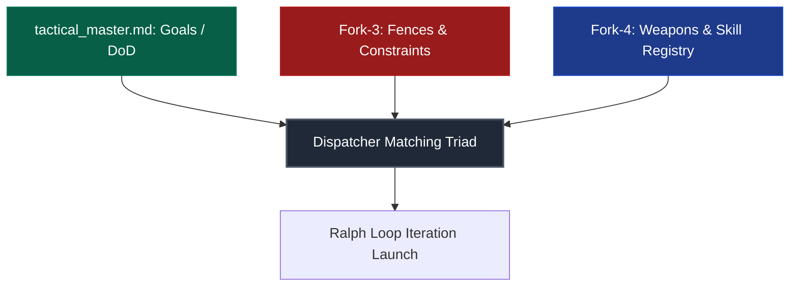
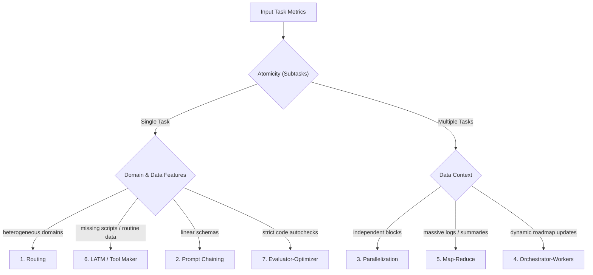

# Harness Protocol: The Cybernetic Control Frame for Autonomous AI Agents

[](https://opensource.org/licenses/Apache-2.0)
[](STRESS_TEST_REPORT.md)
[](#memory-architecture--token-economy)

[Russian Version / Русская версия](README.ru.md)

Welcome to the **Harness Protocol** specification and reference implementation directory. This protocol defines a strict cybernetic control framework regulating how autonomous AI agents interface with local file systems, compilers, execution environments, and testing suites. 

---

## 1. Executive Summary & Core Philosophy

In traditional AI software engineering, LLMs are given loose shell execution and file-writing capabilities. This lack of structure leads to high cognitive variance, context bloat, codebase regressions, and security vulnerability. 

The Harness Protocol addresses this by treating the AI agent not as a standalone developer, but as a dual-component architecture:

$$\text{Agent} = \text{Model} + \text{Harness}$$

- **The Model (LLM)** represents the core reasoning, hypothesis generation, and decision-making engine.
- **The Harness** provides the sandbox environment, restricts tool execution, acts as a deterministic state gate, and enforces absolute safety.

```
                  ┌────────────────────────────────────────┐
                  │                 MODEL                  │
                  │   Reasoning, Planning, Code Writing    │
                  └───────────────────┬────────────────────┘
                                      │
                                  Composes
                                      │
                                      ▼
                  ┌────────────────────────────────────────┐
                  │                HARNESS                 │
                  │  Determines constraints, checks state  │
                  │  runs compilers/tests, issues verdict │
                  └───────────────────┬────────────────────┘
                                      │
                              Validates & Enforces
                                      │
                                      ▼
                             [Working Codebase]
```

### The System Core Goals
1. **Safety & Sandboxing:** A cryptographic and logical guarantee that an AI agent cannot damage host systems or run unauthorized operations.
2. **Determinism:** Wrapping probabilistic text-based models in a deterministic runtime context (compilers, linters, tests, and strict state transitions).
3. **The Ratchet Principle:** Ensuring that any error committed by the AI is analyzed, cataloged, and guarded against by inserting a new test or restriction, preventing future regression loops.

---

## 2. System Architecture & The Cybernetic Contour

At the start of any work cycle, the agent is constrained by the **Matching Triad** of resources:



1. **Task Goal (Master):** The final success criterion (Definition of Done) compiled into the task passport.
2. **Fences (Constraints / Fork-3):** Hard boundaries defining what the model is strictly forbidden to do. If the model attempts to violate these, the execution fails, triggering an immediate reflection cycle.
3. **Weapons (Tools & Skills / Fork-4):** Recommended tools (specialized scripts, MCP servers). The agent can use external CLI commands as long as they do not violate Fork-3 constraints, and must log any new successful tools back to Fork-4.

### Subagent Isolation Laws
- **Session Isolation:** Subagents are spawned with fresh, clean session histories. They do not share active memory logs to prevent cross-contamination.
- **Pre-Context Assembly:** Context is compiled and injected into the first turn of the subagent.
- **External Auditing:** An executor subagent must never evaluate its own result. All evaluations go through a third party (compiler or independent AI judge).

---

## 3. The Gated State Machine

Task progression under the Harness Protocol is managed as a strict, non-skippable gated state machine written to `.harness_state.json`. 

```
 [awaiting_context] ─── contextAssembler --mode init/step ───► [context_served]
         ▲                                                            │
         │                                                        AI works...
         │                                                            │
         │                                                contextAssembler --mode validate
         │                                                            │
         │                                                            ▼
         │                                                      [report_ready]
         │                                                            │
         │                                                   validator --type auto/ai/human
         │                                                            │
         │                                                            ▼
         │ ◄─── loopAdvancer --status SUCCESS ────────────────── [validated]
         │                                                            │
         │                                                     [SYNC_DUE] (drift check)
         │                                                            │
         │                                                       syncCheck.js
         ▼                                                            ▼
  [task_complete]                                             [awaiting_context]
```

### Deterministic State Gates
The following gates act as script-level barriers. If the agent calls a step out of order, the harness blocks execution with a `GATE_FAILED` error code.

| Gating Script | Gate | Allowed Previous State | Block Condition |
| :--- | :--- | :--- | :--- |
| `contextAssembler --mode validate` | **G1** | `context_served` | Blocks if `stage != "context_served"` |
| `validator.js` | **G2** | `report_ready` / `awaiting_subagent_validation` | Blocks if no validation report is generated |
| `loopAdvancer.js` | **G3** | `validated` | Blocks if the node status is not validated |
| `contextAssembler --mode step` | **Drift** | `validated` / `sync_due` resolved | Blocks if `sync_due` is set and `syncCheck` has not run |

### State Configuration Structure (`.harness_state.json`)
```json
{
  "task_id": "TACT-045",
  "stage": "context_served",
  "current_node": "NODE-02",
  "context_mode": "init",
  "context_served_at": "2026-07-10T18:30:00Z",
  "report_ready_at": null,
  "validated_at": null,
  "validation_type": "ai",
  "validation_result": null,
  "last_advanced_at": null
}
```

---

## 4. Memory Architecture & Token Economy

The Harness Protocol splits memory into three distinct operational layers. This design ensures that agent context windows remain lean, reducing prompt token usage by **86% to 99%** over the course of execution.

```
┌────────────────────────────────────────────────────────────────────────┐
│                      L3: STRATEGIC MEMORY (Wiki)                       │
│      Official specifications, architectural standards, knowledge.       │
│                  Read-only. Updates via human approval.                 │
└───────────────────────────────────▲────────────────────────────────────┘
                                    │ (Human Gate Approval)
┌───────────────────────────────────┴────────────────────────────────────┐
│                    L2: TACTICAL MEMORY (Task Passport)                 │
│      A six-file layout containing roadmap, constraints, and logs.      │
│      Edits made exclusively via Node.js scripts.                       │
└───────────────────────────────────▲────────────────────────────────────┘
                                    │ (Compilation & Summary)
┌───────────────────────────────────┴────────────────────────────────────┐
│                  L1: OPERATIONAL MEMORY (Step Buffer)                  │
│      Short-lived JSON buffers containing dry iterations.                │
│      Deleted automatically on node closure.                            │
└────────────────────────────────────────────────────────────────────────┘
```

### The Six-Document L2 Layout
To prevent context bloating, the tactical task memory is structured into six isolated documents located in `memory/tactical/`:

1. **Master Document (`tactical_master.md`):** The task passport, original specifications, human-intervention journals, and the global navigation core.
2. **Fork 1 - Loop Control (`forks/tactical_ralph_loop.md`):** The roadmap, strategy logs, iteration statuses, and DoD criteria. Generated automatically from `.harness_roadmap.json`.
3. **Fork 2 - Work Log (`forks/tactical_work_log.md`):** Development logs split into **Warm Storage** (dry node summaries) and **Hot Storage** (the active node's last 5 iterations).
4. **Fork 3 - Constraints Registry (`forks/tactical_constraints.md`):** The static constraints gathered during Step 2.
5. **Fork 4 - Tools & Skills Registry (`forks/tactical_tools_registry.md`):** Available skills, MCP servers, and scripts.
6. **Fork 5 - Deep Archive (`forks/tactical_archive_dump.md`):** Deep history dumps of completed nodes (Cold Storage), written by `archiveNodeLog.js` on node completion.

### Token Economy Rules
1. **One call instead of five files:** The agent never reads L2 files directly. It runs `contextAssembler.js --mode init\|step` to receive a highly condensed context (e.g., standard L2 naively contains ~2100 tokens; `contextAssembler init` outputs ~200-300 tokens).
2. **Automatic Bookkeeping:** The agent does not modify status files manually. Running `loopAdvancer.js` automatically edits and compacts the L2 Markdown files.
3. **Compass-Less Navigation:** The navigation line indexes (e.g., `[Line 015] -> # headings`) are strictly for Node.js parser lookup. The model is shielded from them to save token space.
4. **Resilient Anchors:** Headings in the files are prefixed with hidden HTML comments (e.g., `<!-- ANCHOR: HEADINGS -->`). The reindexing script (`reindexTactical.js`) uses these anchors to compute line offsets safely.
5. **Trivial Task Bypass:** If a task requires $\le 2$ roadmap steps, the entire L1/L2 layout is bypassed, and details are written straight to `walkthrough.md`, preventing token waste on simple tasks.

---

## 5. Universal Cross-Validation & Gated AI Judges

### The Ban on Self-Validation
To prevent cognitive bias, **an executing AI model is strictly prohibited from validating its own output**. Every validation must be verified by a deterministic tool (`auto`), a separate human approval (`human`), or an independent judge model (`ai`).

```
                ┌──────────────────────────────────────┐
                │             Executor AI              │
                │        writes code/artifacts         │
                └──────────────────┬───────────────────┘
                                   │ (Evidence Diff)
                                   ▼
                 ┌───────────────────────────────────┐
                 │       Independent Judge AI        │
                 │   - Independent fresh session     │
                 │   - Validates against rubric      │
                 │   - Returns pass/fail JSON        │
                 └───────────────────────────────────┘
```

### The Three Validation Channels
1. **`auto` (Deterministic):** Code compiles, linters pass, or unit tests succeed. The verdict relies strictly on exit codes.
2. **`ai` (External LLM Judge):** Run via the `cliTransport.js` multiplexer.
   - Evaluates evidence (for code nodes: `git diff HEAD`, for text nodes: deliverables contents).
   - The judge must return a structured JSON output citing verbatim quotes as evidence:
     ```json
     { "pass": true, "dod_results": { "C1": true }, "evidence": ["verbatim quote"] }
     ```
3. **`human`:** Pauses the harness, generates `validation_report.md`, and awaits a manual `--approve` or `--reject` command from the developer in chat.

### Hardened Judge Mechanics
- **The CLI Judge Chain:** Checked sequentially via a first-alive-wins pipeline configured in `llm-config.json` (e.g., `agy → claude → codex`).
- **Probe F1 Authentication:** The `aiProbe.js` script verifies CLI judges at startup by sending a cryptographic nonce. If the shell responds with a login warning (e.g. "unauthenticated", "IneligibleTier"), it is marked offline and skipped, preventing long task timeouts.
- **Oracle Bypass:** If a node has a deterministic oracle configuration (commands/tests), `validator.js` runs it first. If it passes, the paid LLM judge is skipped to save tokens.
- **Subagent Fallback:** If all external judge services are offline, the validator transitions to `awaiting_subagent_validation`. The agent must spawn a clean, isolated subagent to perform the audit and write the verdict to `ai_judge_verdict.json`, preventing executor-level self-validation.

### Exactly Three Mandatory Human Gates
The AI agent is locked in read-only mode. Human developer intervention is required in only three scenarios:
1. **Strategic Memory publishing:** Adding finalized guidelines/gotchas to the L3 global Wiki.
2. **Git write operations:** Git commits, pushes, and branch updates are blocked. The agent must request developer permission to run them.
3. **Task Escalation:** When the loop fails or constraints cannot be met, hitting a `CRITICAL_FAIL` forces an emergency exit. The agent generates an **Unreachability Report** (original goal, limits, blocked DoD, and proposed modifications) and stops.

---

## 6. The Ralph Loop & The 7 AI Strategies

Execution is split by `artifact_kind`:
- **`code` nodes:** Executed by the IDE agent directly in the working tree.
- **`text` nodes:** Executed by the autonomous `strategyEngine.js` scripting environment.

When executing a roadmap node, the Dispatcher determines the task's atomicity and predictability metrics, selecting one of **7 core strategies**:



### Strategy Configuration Reference

| Strategy | Atomicity | Predictability | Typical Domain / Setting |
| :--- | :---: | :---: | :--- |
| **1. Prompt Chaining** | 1 | High | Linear conversions, translation, documentation over strict JSON schemas. |
| **2. Routing** | 1 | Medium | Domain classification (dispatching to specialized UI, Audio, or Logic sub-agents). |
| **3. Parallelization** | >1 | Medium | Independent file editing, multi-aspect security audits. |
| **4. Orchestrator-Workers** | >1 | Low | Building large features, compiling, fixing compiler errors dynamically. |
| **5. Map-Reduce** | >1 | High | Bulk log analysis, crash dump categorization, codebase-wide searches. |
| **6. LATM / Tool Maker** | 1 | Low | Lacking standard tools, writes a Node.js/Python script to process data. |
| **7. Evaluator-Optimizer** | 1 | Medium-High | Algorithmic implementations, compilation repairs, optimization. |

### Capability Tiers & Model Fallback
Models are classified into four tiers: `frontier`, `advanced`, `medium`, and `light`. If a tier endpoint is exhausted or returns HTTP 500, the loop advancer rotates models inside the tier, escalates upwards, or drops to a local `light` model for basic parsing.

---

## 7. Drift-Guard & Spec Synchronization

As an AI loop progresses, small modifications can drift away from the original specifications. To prevent this, the **Drift-Guard** acts as an audit check:

```
[Nodes Closed Counter] == sync_interval (default: 4)
                      │
                      ▼
               Set State: SYNC_DUE
                      │
                      ▼
          Lock contextAssembler (Step Blocked)
                      │
                      ▼
     Run syncCheck.js (External LLM Judge)
                      │
            ┌─────────┴─────────┐
            ▼                   ▼
      [CONTINUE]       [REQUIRE_CORRECTION]
            │                   │
      Clear Lock &       Add corrective node
      Reset Counter      to roadmap, then
                         run --acknowledge
```

- **`CONTINUE`:** The implementation aligns with the original goal. The lock is removed.
- **`REQUIRE_CORRECTION`:** The implementation has drifted. A corrective node is dynamically appended via `roadmapEdit.js`, and must be closed and acknowledged before the gate unlocks.

---

## 8. Script Reference & CLI Cheat Sheet

All orchestration scripts reside in the `Scripts/` directory.

| Script | Command Parameters | Role | Expected Output |
| :--- | :--- | :--- | :--- |
| `task_initializer.js` | `<task_id> "<task_title>"` | Scaffolds the L2 directory structure and default JSON files. | Creates `memory/tactical/<task_id>/` layout. |
| `roadmapEdit.js` | `<task_dir> <action> [options]` | Manipulates nodes inside the `.harness_roadmap.json` file. Actions: `add-node`, `set-status`, `set-dod`, `set-field`, `set-current`, `set-config`, `list`. | Updates JSON and syncs to Markdown. |
| `contextAssembler.js` | `<task_dir> --mode <init\|step\|status\|validate>` | Generates minimal context for the agent or writes validation reports. | Stdout JSON or `validation_report.md`. |
| `validator.js` | `<task_dir> --node <node_id> --type <auto\|ai\|human> [options]` | Runs the verification check and writes the verdict to the state. | Updates state to `validated` or `awaiting_validation`. |
| `loopAdvancer.js` | `<task_dir> --node <node_id> --status <SUCCESS\|FAIL> [options]` | Appends iteration details, advances node status, checks loop boundaries. | Returns next loop action JSON. |
| `syncCheck.js` | `<task_dir> [--acknowledge]` | Audits the current workspace state against the original goal. | Unlocks the drift gate or reports drift requirements. |
| `cli-judge.js` | `--file <path> [--worker-family <family>]` | Manually run the external LLM judge on a file or diff. | Stdout PASS/FAIL report. |
| `reindexTactical.js` | `<task_dir>` | Updates navigation coordinates and heading offsets in Markdown forks. | Updates `tactical_master.md`. |
| `aiProbe.js` | `[--force]` | Probes CLI judge endpoints and caches results to `.harness/ai_probe.json`. | Caches status, prevents judge call timeouts. |

---

## 9. Code Walkthroughs & Common Commands

### Initializing a Standard Task
```powershell
# 1. Initialize the L2 files and roadmap skeleton
node Scripts/task_initializer.js TACT-045 "Integrate Custom Authentication Systems"

# 2. Add roadmap nodes via roadmapEdit.js
node Scripts/roadmapEdit.js memory/tactical/TACT-045 add-node --id NODE-01 --title "Draft Interface Contracts" --validation auto --kind code --dod "Interface compiles cleanly"
node Scripts/roadmapEdit.js memory/tactical/TACT-045 add-node --id NODE-02 --title "Implement AES-GCM Encryption System" --validation ai --kind code --dod "Encryption passes AI code audit"

# 3. Compile the navigation matrix
node Scripts/reindexTactical.js memory/tactical/TACT-045

# 4. Stop and wait for manual approval: "Реализуй план"
```

### Executing a Node within the Ralph Loop
```powershell
# 1. Serve the node context (run first to transition state to context_served)
node Scripts/contextAssembler.js memory/tactical/TACT-045 --mode init

# [AI Agent executes edits in the workspace]

# 2. Generate the validation report
node Scripts/contextAssembler.js memory/tactical/TACT-045 --mode validate --node NODE-01

# 3. Run validation (auto command triggers compiler/test tools)
node Scripts/validator.js memory/tactical/TACT-045 --node NODE-01 --type auto --cmd "dotnet build"

# 4. Advance the Ralph Loop
node Scripts/loopAdvancer.js memory/tactical/TACT-045 --node NODE-01 --status SUCCESS --insight "Completed standard interface setup"

# 5. Move to the next node
node Scripts/contextAssembler.js memory/tactical/TACT-045 --mode step
```

---

## 10. Quality Assurance & Regression Testing

The Harness Protocol has a complete suite of validation scripts.

- **Unit Testing:** Runs tests covering state machine transitions, CLI transport overflows, and strategy selections.
- **Stress Tester:** Performs an end-to-end simulation of a multi-node task, injecting failures, triggering drift check alerts, and verifying error rollbacks.
- **Regression Smoke Suite:** Ensures script gates cannot be bypassed out of sequence.

To verify the installation, run the regression suite:
```powershell
node Scripts/smoke/run.js
```
All tests must report green. 

```
======================================
     HARNESS PROTOCOL SMOKE TEST
======================================
[INFO] Running 24 integration tests...
[PASS] Sandbox paths resolution (independent cwd)
[PASS] report_ready gate (prevent pre-context validation)
[PASS] validated gate (prevent pre-validation loop advancement)
[PASS] cliTransport large buffer diffs (no ENAMETOOLONG)
[PASS] Drift-guard soft lock and node replication
...
[RESULT] 24/24 validations completed successfully.
======================================
```
For detailed latency metrics and tokens payload records, consult the [Stress Test Report](STRESS_TEST_REPORT.md).
