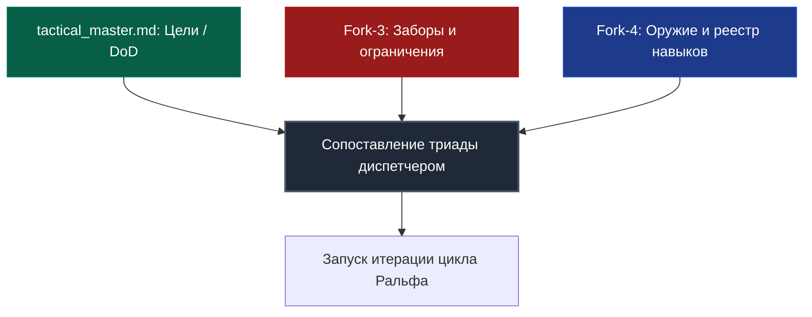
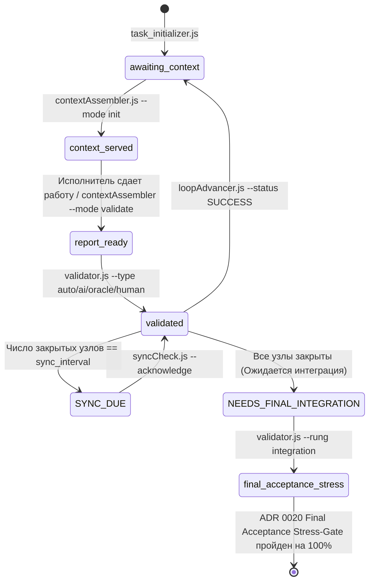

# Harness Protocol: Кибернетический контур управления автономными ИИ-агентами

[](https://opensource.org/licenses/Apache-2.0)
[](Scripts/run_all_tests.js)
[](#integrity-gate)
[-blue)](#langgraph-core)
[](#evidence-ladder)
[](#adr-catalog)


[English Version](README.md)

Добро пожаловать в репозиторий спецификации и референсной реализации **Harness Protocol (Протокола Харнес)**. Этот репозиторий определяет и реализует строгий изолированный кибернетический контур управления, регулирующий взаимодействие автономных ИИ-агентов с локальной файловой системой, компиляторами, средами выполнения, игровыми движками и тестовыми пакетами.

---

## 1. Введение и базовая философия

При классической разработке с ИИ-агентами языковым моделям часто предоставляются бесконтрольный доступ к терминалу и неограниченные права изменения файлов. Отсутствие строгих границ неизбежно приводит к высокой вариативности логики, раздуванию контекста (context bloat), ложноположительным тестам, скрытым архитектурным деградациям и рискам безопасности. При длительной автономной работе вероятностные модели накапливают ошибки, что приводит к бесконечным регрессионным циклам или иллюзии готовности при сломанном коде.

Протокол Харнес решает эту фундаментальную проблему, рассматривая агента не как бесконтрольного разработчика, а как двухкомпонентную кибернетическую систему:

$$\text{Агент} = \text{Модель} + \text{Харнес}$$

* **Модель (LLM)** представляет собой вероятностный движок рассуждений, генерации гипотез и написания кода.
* **Харнес (Контур управления)** обеспечивает детерминированную песочницу, управляет графом состояний, выполняет строгие оракулы (компиляторы, линтеры, тесты), проверяет доказательства выполнения и привлекает независимых состязательных судей.

```
                  ┌────────────────────────────────────────┐
                  │                МОДЕЛЬ                  │
                  │  Рассуждения, планирование, кодинг     │
                  └───────────────────┬────────────────────┘
                                      │
                                 Формирует
                                      │
                                      ▼
                  ┌────────────────────────────────────────┐
                  │                ХАРНЕС                  │
                  │  Ограничивает среду, проверяет стейт,  │
                  │  запускает компиляторы, тесты, судей   │
                  └───────────────────┬────────────────────┘
                                      │
                                Валидирует и
                                контролирует
                                      │
                                      ▼
                             [Рабочая кодовая база]
```

### Основные цели системы
1. **Безопасность и песочница:** Криптографическая и логическая гарантия того, что ИИ-агент не повредит хост-систему, не обратится к недопустимым путям, не допустит утечки секретов и не запустит деструктивные команды.
2. **Детерминизм:** Ограничение вероятностных текстовых выводов модели жестким детерминированным контекстом выполнения (AST-линтеры, компиляторы, стейт-машина и ступени доказательств).
3. **Принцип Храповика (Ratchet Principle):** Любая допущенная ошибка или регрессия детально анализируется, каталогизируется, и для предотвращения ее повторения в проект встраивается постоянный тест, забор или правило.
4. **Исполняемая истина вместо чтения диффов:** Полный запрет на закрытие задач исключительно на основе того, что языковая модель «прочитала git diff». Задача принимается только при наличии исполняемых оракулов, криптографических квитанций и независимого кросс-семейного аудита.

---

## 2. Архитектура системы и кибернетический контур

В начале любого рабочего цикла агент жестко ограничен **Сопоставляющей Триадой** (Matching Triad):



1. **Цель задачи (Master / `tactical_master.md`):** Окончательный критерий успеха (Definition of Done — DoD), зафиксированный в паспорте задачи.
2. **Заборы (Constraints / Fork-3):** Непреодолимые границы, определяющие, что модели строго запрещено делать. Попытка нарушения немедленно блокируется скриптами с запуском цикла рефлексии.
3. **Оружие (Tools & Skills / Fork-4):** Авторизованный арсенал проверенных инструментов (скрипты, MCP-серверы). Модель вправе использовать внешние команды, только если они не нарушают Fork-3, и обязана регистрировать новые успешные инструменты обратно в Fork-4.

### Строгие законы работы агентов
* **Изоляция сессий:** Все субагенты запускаются в абсолютно свежих сессиях чата. Накопление истории из прошлых задач строго запрещено.
* **Предварительная сборка контекста:** Контекст собирается скриптом `contextAssembler.js` и передается субагенту в первом сообщении.
* **Внешний аудит:** Исполнитель никогда не проверяет собственный результат. Все проверки осуществляются третьей стороной (компилятором или независимым ИИ-судьей).
* **Абсолютный запрет на пропуски ошибок (No Skip Law):** Если скрипт, тест или генерация выдали ошибку, процесс останавливается. Пропуск упавшего этапа приравнивается к саботажу. Добавляется узел решения проблемы, дефект устраняется, и только затем цикл возобновляется.
* **Абсолютный запрет на симуляцию других агентов:** Строжайше запрещено эмулировать, придумывать или галлюцинировать ответы других агентов, судей или консольных утилит. Все вызовы должны быть реальными.
* **Правило фоллбека моделей:** При вызове ИИ опрашиваются все доступные модели текущего уровня (tier). Если ни одна не доступна, разрешается спуститься ровно на один уровень ниже. Сдаваться после первой ошибки запрещено.
* **Обязательная проверка компиляции:** Запрещено завершать правку кода без проверки логов компилятора. Любые ошибки компиляции должны быть исправлены немедленно.

### Разделение логики по `artifact_kind`
* **Узлы `code` (код):** Выполняются непосредственно IDE-агентом в рабочем дереве проекта. Уликами для судьи выступают `git diff HEAD`, логи тестов и квитанции компилятора.
* **Узлы `text` (текст):** Могут выполняться автономным движком `strategyEngine`. Уликами выступает содержимое созданных документов, а результаты шагов сохраняются в дисковые контракты `op_*.json`.

---

## <a id="langgraph-core"></a>3. Ядро на базе LangGraph StateGraph и автомат состояний

В версии 3.0 ядром управления Harness Protocol выступает **LangGraph.js (`@langchain/langgraph`)**, обеспечивающий иерархический детерминированный граф выполнения.

```
┌─────────────────────────────────────────────────────────────────────────────┐
│ TaskOrchestratorGraph (thread_id = taskId)                                 │
│                                                                             │
│  [ReadRoadmap] ──► [ScaleGateCheck] ──► [DriftGuardCheck]                   │
│                                                │                            │
│                                                ▼                            │
│                                  [DynamicDecompositionGate]                 │
│                                                │ (ADR 0021 Дробление)       │
│                                                ▼                            │
│                                     [RalphLoopSubgraph]                     │
│                                                │                            │
│                                                ▼                            │
│                                      [CheckTaskStatus]                      │
│                                      ┌─────────┴─────────┐                  │
│                                      ▼                   ▼                  │
│                                 [NextNode]   [FinalAcceptanceStressGate]    │
│                                                          │ (ADR 0020)       │
│                                                          ▼                  │
│                                                    [TaskComplete]           │
└─────────────────────────────────────────────────────────────────────────────┘
```

### 7 канонических субграфов стратегий (`Scripts/graph/strategies/`)
Каждому тактическому узлу назначается специализированный субграф в зависимости от характера работы:

| Стратегия | Файл плагина | Топология и назначение | Дисковый контракт |
| :--- | :--- | :--- | :--- |
| **1. Prompt Chaining** | `chaining.js` | Последовательное пошаговое выполнение пунктов DoD | `op_memory.json` |
| **2. Routing** | `routing.js` | Доменная классификация (`ui`, `audio`, `logic`) и маршрутизация к профильному воркеру | `op_route.json` |
| **3. Parallelization** | `parallelization.js` | Шардирование независимых задач с последующим объединением (Collator) | `op_collated.json` |
| **4. Orchestrator-Workers** | `orchestrator.js` | Динамическое планирование шагов и зависимостей между воркерами | `op_plan.json` |
| **5. Map-Reduce** | `mapReduce.js` | Нарезка объемных данных на чанки, параллельный маппинг и агрегация | `op_reduce_final.json` |
| **6. LATM (Tool Maker)** | `latm.js` | Синтез утилит на лету, проверка синтаксиса (Syntax Guard) и запуск в песочнице | `op_tool_output.json` |
| **7. Evaluator-Optimizer** | `evaluatorOptimizer.js`| Итеративный цикл генерации и критики до достижения порога качества | `op_feedback_loop.json` |

### Управляемый гейтами конечный автомат
Переходы между фазами фиксируются в `.harness_state.json` и дублируются в Write-Ahead Log (`.harness_wal.jsonl`):



### Детерминированные замки состояний (Gates)
* **`contextAssembler --validate`:** Блокируется, если текущее состояние не `context_served`.
* **`contextAssembler --init/step`:** Блокируется, если состояние не `awaiting_context` или активен флаг `sync_due`.
* **`validator.js`:** Блокируется, если в `validation_report.md` отсутствует содержательный раздел `## SELF-REVIEW`.
* **`loopAdvancer.js`:** Блокируется, если активный узел не подтвердил прохождение всех обязательных ступеней оракула.
* **`Final Integration Gate`:** Блокируется, пока не сформирована свежая неизмененная квитанция сквозной интеграции всего проекта.

---

## <a id="evidence-ladder"></a>4. Лестница доказательств и Обязательный пол оракула (Рычаги 1′–6)

Качество рождается не из чтения диффов, а из **исполняемой истины** и **состязательной проверки**.

### Базовый закон (Рычаг 1′)
> Каждый узел проверяется **САМЫМ СИЛЬНЫМ оракулом**, который допускает создаваемый артефакт. Детерминированный пол обязателен и не может быть понижен — агент или человек вправе только повышать строгость. ИИ-судья оценивает ТОЛЬКО то, до чего не дотягивается оракул (соответствие замыслу, архитектурная чистота).

```
                      ┌──────────────────────────────────────┐
                      │          ПРИЕМКА ЧЕЛОВЕКОМ           │ (Ощущения, соответствие GDD)
                      ├──────────────────────────────────────┤
                      │       СОСТЯЗАТЕЛЬНЫЙ ИИ-СУДЬЯ        │ (Архитектура, безопасность, краевые случаи)
                      ├──────────────────────────────────────┤
                      │      ОБЯЗАТЕЛЬНЫЙ ПОЛ ОРАКУЛА        │ (Детерминированное исполнение)
                      │  compile + tests + console + security │
                      └──────────────────────────────────────┘
```

### Классы артефактов и обязательные ступени
Класс назначается через `roadmapEdit.js <dir> add-node ... --class <class>`:

| Класс артефакта | Обязательный пол (детерминированные ступени) | Роль ИИ-судьи |
| :--- | :--- | :--- |
| **`code.testable`** | `compile` + `tests` + `security` | Только соответствие замыслу, архитектура и краевые случаи |
| **`code.behavioral`** | `compile` + `console_clean` + `tests` + `security` | Поведенческий аудит и субъективный UX |
| **`text`** | Детерминированный пол отсутствует | Основная состязательная оценка |

### Квитанции доказательств и снимки исходников
1. **Неизменяемые квитанции (`evidence_receipts.json`):** Каждое выполнение ступени фиксирует криптографическую квитанцию с привязкой к итерации узла. Новая итерация аннулирует старые квитанции.
2. **Снимки исходного кода (`sourceEvidence.js`):** Валидатор фиксирует хэши байтов, структуру папок и таймстампы до и после проверки. Перезапись, откат или временное добавление зависимостей блокируют приемку.
3. **Автоматический аудит безопасности (`securityScan.js`):** Сканирует измененные артефакты на утечки приватных ключей, токенов, учетных данных и опасных конструкций (`eval`, отключенный TLS).
4. **Подсказчик оракулов (`oracleSuggest.js`):** Определяет стек проекта (`node`, `dotnet`, `unity`, `rust`, `python`) и выдает готовые команды для закрытия ступеней пола.

---

## <a id="integrity-gate"></a>5. Универсальная перекрестная валидация, состязательные судьи и рубрика


### 1. Защитный гейт F5 и запрет самовалидации
* **Запрет самовалидации:** Агент-исполнитель никогда не проверяет собственный результат в текущей сессии.
* **Приоритет разных семейств:** Селектор `judgeSelector.js` отдает приоритет судьям из другого семейства моделей (например, исполнитель Claude $\rightarrow$ судья Gemini или GPT).
* **Субагентный фоллбек:** При отсутствии внешних CLI-судей создается задача в `ai_judge_task.md`, и валидатор запрашивает свежего изолированного субагента IDE (`NEEDS_SUBAGENT_JUDGE`).

### 2. Взвешенная состязательная рубрика (`rubric.js`)
ИИ-судья выступает в роли «ред-тим» аудитора с презумпцией подозрительности, оценивая 4 измерения:

$$\text{Итоговый балл} = 0.30 \times \text{Func} + 0.25 \times \text{Qual} + 0.25 \times \text{Sec} + 0.20 \times \text{Edge}$$

* **Жесткий пол безопасности:** Оценка безопасности должна быть $\ge 5.0$.
* **Проходной порог:** Взвешенный балл обязан быть $\ge 7.0$ (`HARNESS_RUBRIC_THRESHOLD`). Недобор баллов переводит номинальный `pass: true` в статус `FAIL`.

### 3. Матрица уровней критичности

| Уровень | Описание | Режим валидации | Механика кворума |
| :--- | :--- | :--- | :--- |
| **L0** | Тривиальный / предопределенный код | **Только детерминированный оракул** | Проверяется строго компилятором/тестами. 0 токенов LLM. |
| **L1** | Стандартная доработка | **Один средний судья** | Оценивается одним cross-family судьей среднего уровня. |
| **L2** | Важное архитектурное изменение | **Один сильный судья** | Оценивается одним сильным cross-family судьей. |
| **L3** | Системный инвариант | **Строгий кворум** | Оценивается двумя независимыми cross-family судьями в консенсусе. |

---

## 6. Трехуровневая архитектура памяти и токен-экономика

Для устранения забивания контекста память задачи разделена на три эшелона:

```
┌────────────────────────────────────────────────────────────────────────┐
│                   L3: ВЕКТОРНАЯ ВИКИ И РЕЕСТР НАВЫКОВ                   │
│   Глобальная база знаний, инварианты, дистиллированные навыки.         │
└───────────────────────────────────▲────────────────────────────────────┘
                                    │ (Одобрение через Human Gate)
┌───────────────────────────────────┴────────────────────────────────────┐
│                   L2: ТАКТИЧЕСКАЯ ПАМЯТЬ (Шестифайловый форк)           │
│   Паспорт задачи, роадмап, заборы, арсенал инструментов, журнал.      │
└───────────────────────────────────▲────────────────────────────────────┘
                                    │ (Сборка и сжатие саммари)
┌───────────────────────────────────┴────────────────────────────────────┐
│                 L1: ОПЕРАТИВНАЯ ПАМЯТЬ (Буфер шага)                   │
│   Короткоживущие JSON-буферы (op_*.json) отдельных итераций.           │
│   Удаляются автоматически после успешного закрытия узла.              │
└────────────────────────────────────────────────────────────────────────┘
```

### Шестифайловый тактический форк (L2)
Все файлы задачи хранятся в `memory/tactical/<task_id>/`:
1. **`tactical_master.md`**: Главный паспорт задачи, спецификация и глобальная навигационная матрица.
2. **`forks/tactical_ralph_loop.md`**: Односторонняя Markdown-проекция `.harness_roadmap.json`.
3. **`forks/tactical_work_log.md`**: Содержит **Теплое хранилище** (сухие саммари закрытых узлов) и **Горячее хранилище** (последние 5 итераций активного узла).
4. **`forks/tactical_constraints.md`**: Реестр жестких заборов и ограничений.
5. **`forks/tactical_tools_registry.md`**: Реестр одобренных навыков и консольных команд.
6. **`forks/tactical_archive_dump.md`**: **Холодное хранилище** подробных дампов, управляемое `archiveNodeLog.js`.

### Доказанная токен-экономика
* **Zero-Manual-Read:** Агент никогда не читает сырые Markdown форки целиком. Скрипт `contextAssembler.js` формирует сжатый JSON-контекст (~200–300 токенов вместо ~2,100), обеспечивая **от 86% до 99% измеренной экономии токенов**.
* **Drift-Guard:** Каждые `sync_interval` закрытых узлов (по умолчанию: 4) выполнение останавливается со статусом `SYNC_DUE`. `syncCheck.js` вызывает внешнего судью для сверки реализации с изначальным ТЗ, исключая скрытый уход в сторону.

---

## 7. Финальный приемочный стресс-гейт и динамическое дробление (ADR 0020 и 0021)

### ADR 0020: Запрет слепого `auto` и обязательный Final Acceptance Stress-Gate
* **Запрет слепого `auto`:** Задача не может быть признана завершенной только потому, что локальный юнит-тест вернул `exit code 0`. Юнит-тесты проверяют лишь изолированные абстракции, но не сквозной пользовательский опыт или стабильность рантайма.
* **`finalAcceptanceStressNode`:** После закрытия последнего узла задача переходит в мета-узел стресс-теста:
  1. Запускается сквозной стресс-тест под нагрузкой и проверка целостности сборки.
  2. Независимый ИИ-судья проводит приемочный аудит на соответствие `tactical_master.md`.
  3. **Петля исправления (Remediation Loop):** Любая обнаруженная ошибка рантайма, дефект верстки или расхождение динамически порождает корректирующие узлы `FIX-*`, возвращая систему в цикл Ральфа до достижения 100% готовности.

### ADR 0021: Динамическая декомпозиция узлов в рантайме (Adaptive Fracturing)
* Роадмап задачи представляет собой динамический направленный ациклический граф (DAG).
* Если узел содержит $\ge 3$ независимых пунктов DoD или скрывает неизвестные дефекты, `dynamicDecompositionGateNode` динамически **расщепляет** узел на под-узлы (`NODE.1`, `NODE.2`).
* Под-узлы выполняются с изолированными контекстами и собственными оракулами до родительского синтеза.

---

## 8. Студийный рантайм и верификация движков (Studio Hardening)

Харнес предоставляет специализированные надежные адаптеры для десктопных игровых движков и веб-рантаймов:

### 1. Ограниченный пакетный раннер Unity (`Scripts/unityRunner.mjs`)
Изолированный адаптер пакетного запуска Unity через один JSON-файл запроса:
* **Preflight (`action: preflight`):** Проверяет версию проекта, манифест пакетов, путь к Editor и SHA-256 хэши C#-исходников без запуска Unity.
* **Компиляция (`operation: compile`):** Выполняет пакетную компиляцию C# с файловыми блокировками.
* **Тесты (`operation: test`):** Запускает наборы EditMode/PlayMode через Unity Test Framework. Результаты парсятся скриптом `parseUnityTestResults.mjs` со строгой валидацией схемы NUnit XML.
* **Сборка (`operation: build`):** Выполняет сборку WebGL и автономных билдов с проверкой отчетов сборки.

### 2. Playwright WebGL Smoke Gate (`Scripts/webglSmoke.mjs`)
Автоматизирует тестирование скомпилированных WebGL-сборок в браузере:
* Раздает артефакты сборки по loopback-адресу со строгой проверкой хэшей.
* Запускает Playwright с пинованным браузером.
* Контролирует загрузку WebAssembly, инициализацию Canvas и состояние объекта (`__harnessUnityState`).
* Эмулирует клики/клавиши и проверяет сохранение состояния после перезагрузки.

### 3. Виртуализированный цикл анимации (`Scripts/headlessLoop.mjs`)
Скрипт проверки веб-игр и canvas-анимаций в режиме `console_clean`:
* Заглушает canvas, DOM и `requestAnimationFrame`.
* Прокачивает тысячи кадров без графического сервера, отлавливая зависания, каскады NaN и ошибки рантайма.

### 4. Ограниченная политика моделей (`Scripts/modelPolicy.js`)
* Обеспечивает строгое соблюдение авторизованных профилей (`HARNESS_STUDIO_PROFILE`) с точным указанием кортежей провайдер/модель/роль/усилие.
* Ведет атомарные межпроцессные бухгалтерские книги резервирования токенов с жесткими тайм-аутами.
* Поддерживает детерминированный оффлайн-режим (`HARNESS_OFFLINE=1`).

---

## 9. Дистрибуция навыков и дистилляция L3

### Фреймворк дистрибуции навыков (`Scripts/skillDistribution.mjs`)
Синхронизирует и верифицирует канонический диспетчерский навык (`.agents/skills/davasko-harness-dispatcher`) между проектами и глобальными папками агента:
* **`check`:** Сравнивает эталон с репликами по пофайловым SHA-256 дайджестам.
* **`plan`:** Формирует неизменяемый криптографический план обновления.
* **`apply`:** Проверяет дайджест плана, создает бэкапы, применяет изменения и пишет журнал отката (`recovery.json`).

### Дистилляция архитектурных навыков (`Scripts/graph/skillDistiller.js`)
После успешного закрытия архитектурного узла L3 `skillDistiller.js` извлекает формулу решения, очищает ее от контекста конкретного проекта и упаковывает в готовый переиспользуемый навык в `.agents/skills/distilled-*/`.

---

## 10. Полный каталог скриптов и консольная шпаргалка

Все скрипты находятся в `Scripts/` и работают нативно в Node.js:

| Скрипт | Пример запуска | Основная роль | Выходной артефакт |
| :--- | :--- | :--- | :--- |
| **`task_initializer.js`** | `node Scripts/task_initializer.js TACT-01 "Задача"` | Развертывание структуры L2 и JSON-состояний | Папка `memory/tactical/TACT-01/` |
| **`roadmapEdit.js`** | `node Scripts/roadmapEdit.js <dir> add-node --id N1` | Редактирование узлов, критериев DoD и конфигов | `.harness_roadmap.json` |
| **`contextAssembler.js`** | `node Scripts/contextAssembler.js <dir> --mode init` | Сборка контекста и генерация отчетов валидации | `validation_report.md` |
| **`validator.js`** | `node Scripts/validator.js <dir> --node N1 --type oracle` | Запуск оракулов, ступеней пола и вызов судей | `evidence_receipts.json` |
| **`loopAdvancer.js`** | `node Scripts/loopAdvancer.js <dir> --node N1 --status SUCCESS` | Продвижение по циклу Ральфа, гейт интеграции | Обновленный `.harness_state.json` |
| **`evidenceLadder.js`** | `node Scripts/evidenceLadder.js <dir> --node N1` | Контроль обязательного пола оракула | Пропуск или отказ гейта |
| **`sourceEvidence.js`** | `node Scripts/sourceEvidence.js <dir>` | Хэширование исходников и обнаружение подмен | Дерево SHA-256 хэшей |
| **`oracleSuggest.js`** | `node Scripts/oracleSuggest.js <dir> --class code.testable` | Определение стека и генерация команд оракула | Список команд для ступеней |
| **`syncCheck.js`** | `node Scripts/syncCheck.js <dir> [--acknowledge]` | Сверка реализации с изначальным ТЗ (Drift-Guard) | Статус схождения / узел коррекции |
| **`aiProbe.js`** | `node Scripts/aiProbe.js` | Зондирование авторизации CLI-судей одноразовыми nonces | `.harness/ai_probe.json` |
| **`unityRunner.mjs`** | `node Scripts/unityRunner.mjs <request.json>` | Пакетный запуск Unity (компиляция, тесты, сборка) | Структурированный JSON-отчет |
| **`webglSmoke.mjs`** | `node Scripts/webglSmoke.mjs <request.json>` | Браузерный смоук-тест WebGL на Playwright | Трейсы и скриншоты |
| **`headlessLoop.mjs`** | `node Scripts/headlessLoop.mjs <file.html> --frames 3000` | Прокачка виртуализированных rAF canvas циклов | Чистый выход или трейс ошибки |
| **`skillDistribution.mjs`**| `node Scripts/skillDistribution.mjs check --source ...` | Проверка и дистрибуция навыков диспетчера | План и журнал восстановления |
| **`run_all_tests.js`** | `npm test` | Мастер-тестер запуска всех 18 наборов проверок | Сводный отчет о прохождении |

---

## 11. Установка и запуск мастер-тестера

### Системные требования
* **Node.js** версии 18.0.0 или выше (с поддержкой ESM).
* **Git** в системной переменной PATH.
* Авторизованный CLI-доступ хотя бы к одному поддерживаемому ИИ (Google Antigravity `agy`, Claude Code `claude`, OpenAI `codex`).

### 1. Установка
```powershell
git clone <ссылка-на-репозиторий> HarnessProtocol
cd HarnessProtocol
npm install
```

### 2. Проверка доступности судей
```powershell
node Scripts/aiProbe.js
```
Скрипт проверяет авторизацию моделей уникальным nonce-кодом. Неавторизованные модели исключаются без карантина; перманентно недоступные отправляются на 24-часовой карантин.

### 3. Запуск мастер-набора из 18 тестовых сьютов
```powershell
npm test
```
Мастер-тестер проходит все 18 сьютов системы менее чем за 45 секунд:
```
═══════════════════════════════════════════════════════════════════════
       🛡️  HARNESS PROTOCOL — MASTER TEST RUNNER & VERIFIER           
═══════════════════════════════════════════════════════════════════════

▶️ Запуск: 1. Модули эффективности (SyntaxGuard, ContractFormalizer, SkillDistiller, Checkpointer)...
✅ [УСПЕХ] 1. Модули эффективности
▶️ Запуск: 2. Изолированные сабграфы 7 канонических стратегий LangGraph...
✅ [УСПЕХ] 2. Изолированные сабграфы 7 канонических стратегий LangGraph
▶️ Запуск: 3. Сквозной интеграционный тест LangGraph StateGraph рантайма...
✅ [УСПЕХ] 3. Сквозной интеграционный тест LangGraph StateGraph рантайма
...
▶️ Запуск: 12. Лестница доказательств: пол оракула, классы артефактов, ratchet...
✅ [УСПЕХ] 12. Лестница доказательств
▶️ Запуск: Studio hardening (test_unity_results, test_webgl_smoke, test_model_policy, etc.)...
✅ [УСПЕХ] Studio hardening suites

═══════════════════════════════════════════════════════════════════════
ИТОГИ ВСЕГО ТЕСТОВОГО СЬЮТА: 18/18 запускаемых сьютов пройдено за ~40с
Сбоев: 0 | Пропущено (опциональные): 2
═══════════════════════════════════════════════════════════════════════
```

---

## 12. Пошаговый сценарий исполнения задачи (Цикл Ральфа)

### Шаг 1: Инициализация задачи и роадмапа
```powershell
# 1. Создаем структуру файлов L2
node Scripts/task_initializer.js TACT-101 "Реализация защищенного хранилища токенов"

# 2. Добавляем узлы роадмапа с указанием класса артефакта и DoD
node Scripts/roadmapEdit.js memory/tactical/TACT-101 add-node --id NODE-01 --title "Описать интерфейс хранилища" --class code.testable --dod "Интерфейс чисто компилируется без предупреждений линтера"
node Scripts/roadmapEdit.js memory/tactical/TACT-101 add-node --id NODE-02 --title "Реализовать хранилище AES-GCM" --class code.testable --dod "Юнит-тесты проходят на 100% и пройден аудит безопасности"

# 3. Пересчитываем матрицу навигации
node Scripts/reindexTactical.js memory/tactical/TACT-101
```

### Шаг 2: Исполнение узла по Лестнице доказательств
```powershell
# 1. Собрать контекст шага (переводит стейт в 'context_served')
node Scripts/contextAssembler.js memory/tactical/TACT-101 --mode init

# [ИИ-разработчик пишет код в рабочей директории]

# 2. Выполнить и зафиксировать обязательные ступени пола оракула
node Scripts/validator.js memory/tactical/TACT-101 --node NODE-01 --type oracle --rung compile --cmd "npm run build"
node Scripts/validator.js memory/tactical/TACT-101 --node NODE-01 --type oracle --rung tests --cmd "npm test"
node Scripts/validator.js memory/tactical/TACT-101 --node NODE-01 --type oracle --rung security

# 3. Сгенерировать отчет валидации (содержит diff и содержательный ## SELF-REVIEW)
node Scripts/contextAssembler.js memory/tactical/TACT-101 --mode validate --node NODE-01

# 4. Вызвать состязательного ИИ-судью
node Scripts/validator.js memory/tactical/TACT-101 --node NODE-01 --type ai

# 5. Продвинуть узел в статус SUCCESS
node Scripts/loopAdvancer.js memory/tactical/TACT-101 --node NODE-01 --status SUCCESS --insight "Интерфейс хранилища полностью удовлетворяет DoD"

# 6. Перейти к следующему узлу
node Scripts/contextAssembler.js memory/tactical/TACT-101 --mode step
```

---

## <a id="adr-catalog"></a>13. Реестр архитектурных решений (Каталог ADR)

Все фундаментальные архитектурные инварианты зафиксированы в [`docs/adr/`](docs/adr/):

| ADR | Название решения | Краткая суть | Статус |
| :--- | :--- | :--- | :--- |
| **0001** | Isolated Context for AI Judge | Запрет самовалидации; свежий контекст для ИИ-судьи | Принято |
| **0002** | File-Based Gated State Machine | Детерминированное сохранение состояний на диск (`.harness_state.json`) | Принято |
| **0003** | Tri-Tier Memory Hierarchy | Трехуровневая память: L1 оперативная, L2 тактическая (6 форков), L3 база знаний | Принято |
| **0004** | L1 Disk Contracts Over Chat | Обмен данными между агентами строго через JSON-контракты (`op_*.json`) | Принято |
| **0005** | Periodic Drift-Guard Sync | Периодический аудит отклонений реализации от исходного ТЗ | Принято |
| **0006** | Brain Partitioning by Artifact Kind | Прямое исполнение IDE для `code`; автономный движок для `text` | Принято |
| **0007** | Strict Triad of Mandatory Human Gates| Обязательные гейты человека строго ограничены Wiki, Git и эскалацией | Принято |
| **0008** | Scale Gating and Workflow Limits | Лимиты безопасности, предотвращающие неконтролируемый параллелизм | Принято |
| **0009** | Preflight Quarantining & Cross-Family | Зондирование судей nonces; приоритет судей из других семейств моделей | Принято |
| **0010** | Tiered Criticality & Quorum | Уровни от L0 (оракул) до L3 (кворум согласия двух судей) | Принято |
| **0011** | Marker-Based Repository Anchor | Детерминированное вычисление путей по маркерному файлу корня | Принято |
| **0012** | Context Assembler & Token Economy | Точечная сборка контекста, экономящая 86–99% токенов | Принято |
| **0013** | File/Stdin Transport Isolation | Передача инструкций только через файлы/stdin, исключая `ENAMETOOLONG` | Принято |
| **0014** | Deterministic Security Policy | Белые списки разрешенных бинарников, инструментов и фильтр команд | Принято |
| **0015** | F5 Integrity Gate & Stress Testing | Автоматизированные позитивные и негативные тесты гейтов и границ | Принято |
| **0016** | Model Tournament & Capability Tiering| Эмпирическая калибровка надежности и задержек моделей разных семейств | Принято |
| **0017** | Specialized Workflow Environments | Распределение фазовых бюджетов в специализированных сценариях | Принято |
| **0018** | Task Archiving & Retention Lifecycle | Регламент архивации завершенных досье задач в `memory/archive/` | Принято |
| **0019** | LangGraph StateGraph & Subgraphs | Перевод архитектуры на иерархический граф состояний LangGraph.js | Принято |
| **0020** | Ban on Uncontrolled Auto & Stress Gate| Полный запрет слепого `auto`; обязательный Final Acceptance Stress-Gate | Принято |
| **0021** | Dynamic Node Decomposition (Fracturing)| Динамическое дробление крупных узлов в рантайме на атомарные под-узлы | Принято |

---

## 14. Лицензия

Harness Protocol распространяется под лицензией **Apache License, Version 2.0**. См. подробности в файле [`LICENSE`](LICENSE).
