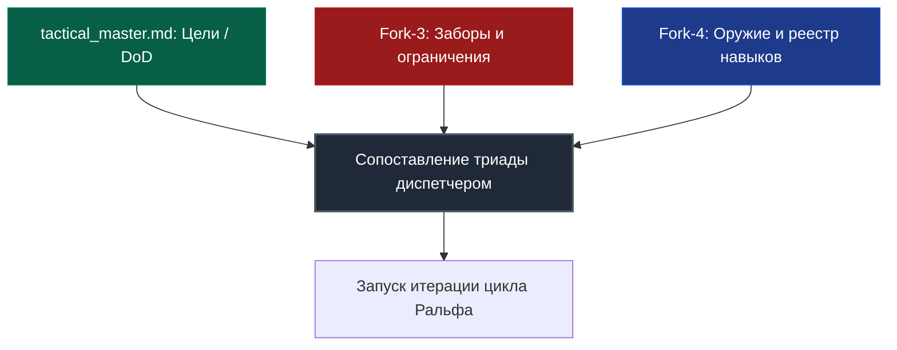
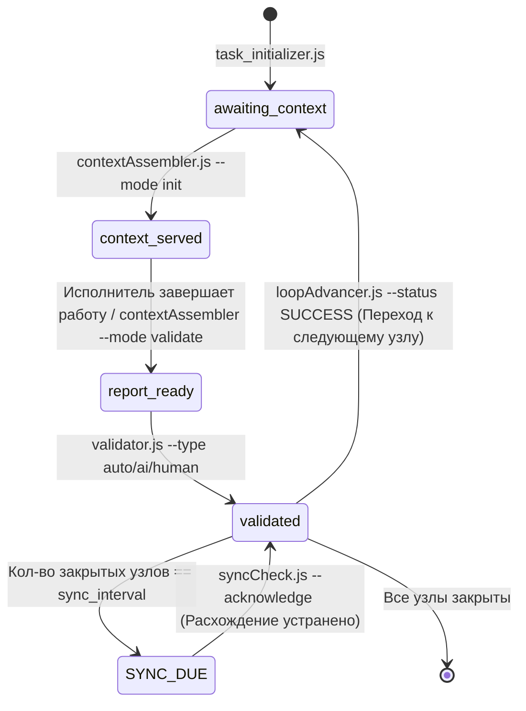
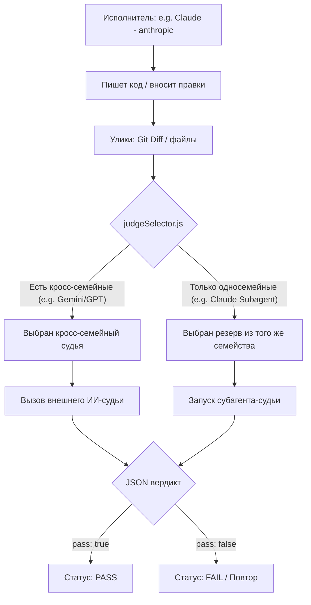
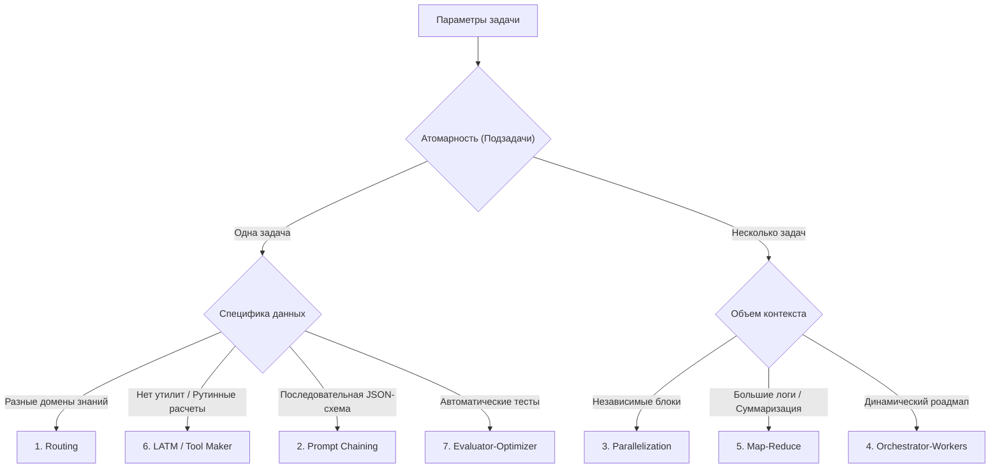

# Harness Protocol: Кибернетический контур управления автономными ИИ-агентами

[](https://opensource.org/licenses/Apache-2.0)
[](Scripts/smoke/run.js)
[](#5-универсальная-перекрестная-валидация-и-защитный-гейт-f5)
[](#3-архитектура-системы-и-кибернетический-контур)

[English Version](README.md)

Добро пожаловать в спецификацию и референсную реализацию **Harness Protocol (Протокола Харнес)**. Этот репозиторий определяет и реализует строгий изолированный кибернетический контур управления взаимодействием автономных ИИ-агентов с локальной файловой системой, компиляторами, средами выполнения и тестовыми пакетами.

---

## 1. Введение и базовая философия

При классической разработке с ИИ-агентами языковым моделям часто предоставляются неограниченные возможности выполнения команд и изменения файлов. Отсутствие структуры приводит к высокой вариативности логики, раздуванию контекста (bloat), регрессиям кодовой базы и угрозам безопасности. При длительной автономной работе модели накапливают незамеченные ошибки компиляции или логики, что приводит к бесконечным циклам регрессий или скрытому разрушению структуры.

Протокол Харнес решает эту проблему, рассматривая ИИ-агента не как самостоятельного разработчика, а как двухкомпонентную кибернетическую систему:

$$\text{Агент} = \text{Модель} + \text{Харнес}$$

* **Модель (LLM)** отвечает за рассуждения, выработку гипотез и принятие решений. Она работает вероятностно.
* **Харнес (Окружение)** создает изолированную песочницу, ограничивает выполнение инструментов, выступает в роли детерминированного гейта состояний и гарантирует безопасность. Он работает детерминированно.

```
                  ┌────────────────────────────────────────┐
                  │                МОДЕЛЬ                  │
                  │  Рассуждения, планирование, кодинг     │
                  └───────────────────┬────────────────────┘
                                      │
                                 Формирует
                                      │
                                      ▼
                  ┌────────────────────────────────────────┐
                  │                ХАРНЕС                  │
                  │  Проверяет ограничения и состояния,   │
                  │  запускает компиляторы/тесты, судья    │
                  └───────────────────┬────────────────────┘
                                      │
                                Валидирует и
                                 контролирует
                                      │
                                      ▼
                             [Рабочая кодовая база]
```

### Основные цели системы
1. **Безопасность и песочница:** Криптографическая и логическая гарантия того, что ИИ-агент не повредит хост-систему, не обратится к недопустимым путям и не запустит неавторизованные скрипты.
2. **Детерминизм:** Ограничение вероятностных текстовых выводов модели жестким детерминированным контекстом выполнения (компиляторы, линтеры, тесты и строго фиксированные состояния).
3. **Принцип Храповика (Ratchet Principle):** Любая допущенная ИИ ошибка детально анализируется, каталогизируется, и для предотвращения ее повторения в проект встраивается новый тест или ограничение.

---

## 2. Архитектура системы и кибернетический контур

В начале любого рабочего цикла агент ограничен **Сопоставляющей Триадой** (Matching Triad):



1. **Цель задачи (Master):** Конечный критерий успешности выполнения (Definition of Done), записанный в паспорте задачи.
2. **Заборы (Constraints / Fork-3):** Жесткие ограничения на действия модели. Если модель пытается нарушить границу, выполнение блокируется на уровне скриптов, запуская цикл рефлексии.
3. **Оружие (Tools & Skills / Fork-4):** Рекомендованный арсенал инструментов (скрипты, MCP-серверы). Агент имеет право применять любые другие доступные в системе инструменты (если они не нарушают Fork-3), но обязан вносить успешные решения обратно в реестр Fork-4.

### Законы изоляции субагентов
* **Изоляция сессий:** Все субагенты запускаются в абсолютно свежих сессиях чата. Накопление истории из прошлых запусков или смежных задач строго запрещено.
* **Предварительная сборка контекста:** Контекст собирается диспетчером/скриптами и передается субагенту в первом же сообщении.
* **Внешний аудит:** Субагент-исполнитель никогда не проверяет собственный результат во избежание «подыгрывания» своим галлюцинациям. Все проверки осуществляются третьей стороной (компилятором или независимым ИИ-судьей).

### Разделение логики по `artifact_kind`
Контур Харнеса разделяет процессы в зависимости от типа создаваемого артефакта:
* **Узлы `code` (код):** Выполняются непосредственно IDE-агентом в кодовой базе проекта. В качестве улик для ИИ-судьи передается строго `git diff HEAD`.
* **Узлы `text` (текст):** Могут выполняться автономным движком `strategyEngine`. В качестве улики передается содержимое созданного файла, а результаты шагов пишутся в служебные файлы `op_*.json`.

---

## 3. Управляемый гейтами конечный автомат (State Machine)

Прохождение задачи под контуром Харнеса управляется жестким, не допускающим пропусков конечным автоматом, фиксирующим шаги в файле `.harness_state.json`.



### Детерминированные блокировки (State Gates)
Скрипты прерывают выполнение с ошибкой, если шаги жизненного цикла нарушены:
* **Гейт `contextAssembler --validate`:** Блокирует вызовы, если текущая стадия не равна `context_served`. Предотвращает попытки валидировать работу до того, как был подан контекст.
* **Гейт `contextAssembler --init/step`:** Блокирует сборку контекста, если стадия не равна `awaiting_context` или если активен флаг расхождения ТЗ (`sync_due`).
* **Гейт `validator.js`:** Не позволяет запустить валидацию, если в директории шага отсутствует сформированный отчет `validation_report.md`.
* **Гейт `loopAdvancer.js`:** Не позволяет закрыть узел, пока тот не получит вердикт `PASS` от валидатора (вердикт `FAIL` переводит состояние обратно в `awaiting_context` для доработки).
* **Гейт многоагентных стратегий:** Блокирует валидацию шага, если в среде выполнения отсутствуют обязательные файлы `op_*.json`.

---

## 4. Архитектура памяти и экономика токенов

Для предотвращения раздувания контекста (которое снижает качество логики модели и приводит к ошибкам), тактическая память конкретной задачи делится на **L1 (Оперативную)** и **L2 (Тактическую)**.

```
┌────────────────────────────────────────────────────────────────────────┐
│                   L2: ТАКТИЧЕСКАЯ ПАМЯТЬ (Форк из 6 файлов)            │
│   Долгоживущие спецификации, логи, ограничения и роадмап.             │
└───────────────────────────────────▲────────────────────────────────────┘
                                    │ (Компиляция и суммаризация)
┌───────────────────────────────────┴────────────────────────────────────┐
│                 L1: ОПЕРАТИВНАЯ ПАМЯТЬ (Буфер шага)                   │
│   Короткоживущие JSON-файлы с сухими фактами итераций шага.         │
│   Удаляются автоматически после закрытия узла роадмапа.             │
└────────────────────────────────────────────────────────────────────────┘
```

### Шестифайловая тактическая структура L2
Все файлы сохраняются в директории `memory/tactical/<task_id>/`:
1. **`tactical_master.md`**: Главный паспорт задачи. Содержит исходное ТЗ, журнал вмешательства разработчика и общую матрицу навигации.
2. **`forks/tactical_ralph_loop.md`**: План шагов (роадмап), лог итераций и критерии DoD. Генерируется из `.harness_roadmap.json`.
3. **`forks/tactical_work_log.md`**: Журнал работы. Содержит **Warm Storage** (сухие выжимки закрытых узлов) и **Hot Storage** (последние 5 итераций активного узла).
4. **`forks/tactical_constraints.md`**: Статический реестр заборов и ограничений, собранный на этапе интервью.
5. **`forks/tactical_tools_registry.md`**: Реестр инструментов (MCP-серверы, навыки, разрешенные утилиты).
6. **`forks/tactical_archive_dump.md`**: **Cold Storage** с подробными архивами закрытых шагов, сжимаемый с помощью `archiveNodeLog.js`.

### Оптимизация памяти и токенов
* **Сжатие контекста:** Агент никогда не читает L2-файлы целиком. Он запрашивает `contextAssembler.js`, который генерирует сжатую выжимку (~200–300 токенов вместо ~2,100 токенов сырого Markdown), что экономит до 90% бюджета.
* **Устойчивые якоря:** Скрытые HTML-комментарии (например, `<!-- ANCHOR: ID -->`) защищают заголовки документов. Координаты пересчитываются `reindexTactical.js` автоматически.
* **Сжатие истории (Compactor):** В `Hot Storage` хранится детальная история только последних 5 итераций активного шага. Более старые итерации сжимаются до одной резюмирующей строки, предотвращая переполнение памяти.

---

## 5. Универсальная перекрестная валидация и защитный гейт F5

> [!IMPORTANT]
> **Запрет на самовалидацию:** Выполняющий задачу ИИ-агент **категорически не имеет права оценивать собственный результат**. Любой шаг должен быть проверен автоматическим тестом (`auto`) или независимым внешним ИИ-судьей (`ai`).

### 1. Защитный гейт F5 (Приоритет кросс-семейств и запрет самовалидации)
Для исключения предвзятости и «подыгрывания» собственным галлюцинациям вводится проверка изоляции сессий:
* **Запрет на самовалидацию:** Выполняющий задачу ИИ-агент (воркер) **категорически не имеет права** оценивать собственный результат в рамках той же активной сессии.
* **Приоритет кросс-семейств:** Алгоритм выбора судей отдает приоритет моделям из семейств, отличных от семейства воркера. Например, если воркером выступает Claude (семейство `anthropic`), система постарается назначить судью из семейств Google (`google`/`agy`) или OpenAI (`openai`/`codex`).
* **Резерв из того же семейства (Same-Family Fallback):** Если кросс-семейные судьи отсутствуют или оффлайн, протокол разрешает использовать судей из того же семейства (например, независимого субагента на базе Claude). Главное условие — они должны запускаться в **абсолютно свежем, изолированном контексте (сессии)**, передавая строго подготовленный diff/улики и не имея доступа к истории чата воркера.



### 2. Ограничение субагента-резерва (Subagent-Fallback)
При отсутствии живых внешних CLI-судей (оффлайн режим или лимиты API) валидатор делегирует проверку независимому субагенту:
1. Скрипт выгружает задание для судьи в файл `ai_judge_task.md`.
2. Состояние переходит в `awaiting_subagent_validation`, возвращая `NEEDS_SUBAGENT_JUDGE`.
3. Среда разработки запускает нового изолированного субагента-судью со свежим контекстом.
4. Субагент оценивает результат работы и записывает JSON-вердикт в `ai_judge_verdict.json`.
5. Валидатор принимает вердикт, сохраняя его в режиме `subagent_fallback`. В оффлайн-режиме допускается вынесение вердикта субагентом того же семейства (например, Claude оценивает работу Claude воркера) для предотвращения бесконечных блокировок.

### 3. Вердикт с обязательным цитированием улик
ИИ-судья не может вернуть пустой `pass: true`. В JSON-ответе обязательно должно присутствовать поле `evidence` с массивом точных цитат из предоставленного diff или файлов, доказывающих выполнение DoD. Вердикт без цитирования отклоняется валидатором (эквивалентно `FAIL`).

### 4. Оптимизация детерминированного оракула (L0 Bypass)
Для экономии токенов и ускорения проверок скрипт `validator.js` обходит вызов ИИ-судей:
* Если шаг относится к критичности `L0` (механические правки), ИИ-судья не вызывается вовсе.
* Если у шага есть параметр `--cmd` (например, команда компиляции `dotnet build`), валидатор запускает её. При успешном выполнении ИИ-судья пропускается (`judge: 'deterministic_oracle'`).

---

## 6. Динамический выбор судей (`judgeSelector.js`)

Алгоритм выбора судей рассчитывается в `judgeSelector.js` без побочных эффектов на основе критичности и типа задачи:

### Таблица уровней критичности

| Уровень | Описание | Режим валидации | Механика принятия вердикта |
| :--- | :--- | :--- | :--- |
| **L0** | Простые / Механические правки | **Deterministic Oracle Only** | Проверка компилятором/тестами. ИИ-судья не вызывается для экономии токенов. |
| **L1** | Стандартные правки | **Single Medium Judge** | Оценка одним *medium* кросс-семейным судьей. |
| **L2** | Важные правки | **Single Strong Judge** | Оценка одним *strong* кросс-семейным судьей. |
| **L3** | Критические правки | **Strong Quorum** | Оценка кворумом из 2 судей разных семейств. При наличии лишь одного судьи запускается режим **dual-order** (два порядка улик). |

### Правила ранжирования кандидатов
`judgeSelector` оценивает и сортирует список живых судей по следующим критериям:
1. **Исключение семейства воркера:** Фильтрует кандидатов, удаляя те модели, которые принадлежат к семейству исполнителя.
2. **Артефактное соответствие (Fit Score):**
   * Для кода (`code`) приоритет отдается OpenAI (`codex`/`gpt`).
   * Для текстов/спецификаций (`text`) приоритет отдается Anthropic (`claude`).
3. **Задержка ответа (Latency):** Предпочтение отдается более быстрым моделям.
4. **Стоимость (Cost Tier):** Бесплатные (`free_tier`) или встроенные в среду разработки (`included` субагент) модели имеют приоритет над коммерческими API (`paid`).
5. **Стабильный ID:** Алфавитная сортировка в качестве финального разделителя для сохранения детерминизма.

---

## 7. Доктрина тиров моделей (Model-Tier Doctrine)

Для рационального расхода ресурсов роли агентов привязаны к определенным тирам возможностей:

| Роль | Тир по умолчанию | Допустимые тиры | Семейства моделей | Назначение |
| :--- | :---: | :---: | :--- | :--- |
| **worker** | `cheap` | `cheap`, `medium` | `claude`, `agy`, `codex` | Механическое написание кода, правка файлов. |
| **judge** | `medium` | `medium`, `high`, `max` | `agy`, `codex`, `claude-subagent` | Анализ diff и выдача вердикта (read-only). |
| **evaluator** | `high` | `medium`, `high`, `max` | `agy`, `codex`, `claude-subagent` | Углубленный аудит безопасности и качества (read-only). |
| **reasoner** | `max` | `max` | `claude`, `agy`, `codex` | Проектирование планов, решение сложных багов. |
| **researcher** | `max` | `high`, `max` | `claude`, `agy`, `codex` | Поиск информации, работа с базой знаний. |
| **manager** | `top` | `top`, `max` | `claude`, `agy`, `codex` | Общая координация и взаимодействие с человеком. |

### Конкретные модели в тирах
Список доступных системных моделей описан в `config/harness.config.json` и каталоге `llm-models-catalog.json`:
* `cheap`: Gemini 3.5 Flash, Claude Haiku 4.5, GPT-5.6 Luna.
* `medium`/`high`: Gemini 3.1 Pro, Claude Opus 4.7, GPT-5.6 Terra.
* `max`/`top`: Gemini 3.5 Pro, Claude Fable 5, GPT-5.6 Sol.

### Лимиты токенов (Token Budgets)
Для каждой роли задается жесткий лимит `budget_tokens` (например, воркер = 60,000, судья = 20,000). Перед отправкой запроса `cliTransport` оценивает размер промпта. Если он превышает лимит, вызов блокируется с ошибкой `BUDGET_EXCEEDED`, исключая бессмысленный перерасход токенов.

---

## 8. Цикл Ральфа и 7 ИИ-стратегий

При обработке каждого шага Диспетчер рассчитывает параметры атомарности и предсказуемости, выбирая одну из **7 стратегий**:



### Справочная таблица стратегий

| Стратегия | Предсказуемость | Сфера применения / Специфика |
| :--- | :---: | :--- |
| **1. Prompt Chaining** | Высокая | Линейные преобразования, написание документации по строгим JSON-схемам. |
| **2. Routing** | Средняя | Классификация доменов (передача задач субагентам UI, Audio, Physics). |
| **3. Parallelization** | Средняя | Параллельное редактирование независимых файлов, аудит безопасности. |
| **4. Orchestrator-Workers** | Низкая | Сборка крупных фич, устранение ошибок компиляции «на лету». |
| **5. Map-Reduce** | Высокая | Анализ больших объемов логов, сканирование репозитория. |
| **6. LATM (Tool Maker)** | Низкая | Написание временных скриптов (Python/JS) при нехватке штатных утилит. |
| **7. Evaluator-Optimizer** | Средне-высокая | Оптимизация алгоритмов, математические вычисления, доработка тестов. |

---

## 9. Drift-Guard (Защита от отклонений)

Чтобы код ИИ в процессе работы не уходил в сторону от изначального ТЗ, каждые несколько шагов срабатывает **Drift-Guard**:

```
[Кол-во закрытых узлов] == sync_interval (default: 4)
                        │
                        ▼
                 Статус: SYNC_DUE
                        │
                        ▼
          Lock contextAssembler (Блокировка шага)
                        │
                        ▼
        Запуск syncCheck.js (Внешний ИИ-судья)
                        │
              ┌─────────┴─────────┐
              ▼                   ▼
        [CONTINUE]       [REQUIRE_CORRECTION]
              │                   │
       Снятие блока &    Добавление корректирующего
       сброс счетчика    узла в роадмап через
                         roadmapEdit.js (--acknowledge)
```

* **`CONTINUE`**: Отклонений нет, цикл продолжается.
* **`REQUIRE_CORRECTION`**: Обнаружено расхождение. В роадмап встраивается корректирующая задача, блокирующая работу до ее закрытия.

---

## 10. Механизмы ужесточения и стабильности (Harness Hardening)

### 1. Песочницы судей в режиме "Только чтение"
ИИ-судьи вызываются со строгими флагами безопасности, блокирующими создание или запись файлов:
* Модели Claude: запускаются с флагом `--allowedTools Read Grep Glob` (запрет выполнения shell-команд и изменения файлов).
* Модели Gemini/Agy: запускаются с флагом `--sandbox`.
* Модели OpenAI/Codex: запускаются с флагом `-s read-only`.

### 2. Персистентность рабочих сессий
Для многошаговых воркер-задач `cliTransport` умеет повторно использовать одну и ту же активную сессию (через флаги `--session-id` / `--resume` в Claude). Это позволяет передавать во втором и последующих шагах только дельту инструкций, сокращая объем промпта на ~98%. Судьи при этом всегда остаются stateless (без сессий).

### 3. Защитный журнал транзакций (WAL)
Каждое изменение состояния сохраняется в файл журнала транзакций с дозаписью: `<task_dir>/.harness_wal.jsonl`. При аварийной остановке или зависании запуск команды `node Scripts/stateStore.js <task_dir> --resume` восстановит состояние стейт-машины до последней контрольной точки.

### 4. Обязательное резюмирование шага (Handoff Summary)
При завершении шага исполнитель обязан сформировать краткое резюме `## SUMMARY` (до 300 токенов). Контекст для следующего шага собирается из этих сжатых саммари закрытых узлов, а не из сотен строк логов и исходников, экономя оперативную память.

---

## 11. Справочник скриптов и консольная шпаргалка

Все скрипты лежат в папке `Scripts/` и запускаются через Node.js (без внешних зависимостей npm).

| Скрипт | Пример вызова | Роль | Результат |
| :--- | :--- | :--- | :--- |
| **`task_initializer.js`** | `node Scripts/task_initializer.js TACT-101 "Имя Таски"` | Инициализация файлов задачи L2. | Создает структуру `memory/tactical/TACT-101/`. |
| **`roadmapEdit.js`** | `node Scripts/roadmapEdit.js <dir> add-node --id N1 --title "Подготовка"` | Добавление/правка узлов роадмапа. | Записывает узел в JSON и обновляет Markdown. |
| **`contextAssembler.js`** | `node Scripts/contextAssembler.js <dir> --mode init` | Сборка контекста шага. | Выдает сжатый JSON/Markdown с контекстом. |
| **`validator.js`** | `node Scripts/validator.js <dir> --node N1 --type ai` | Запуск проверки (тесты/ИИ). | Записывает вердикт PASS / FAIL / UNVALIDATED. |
| **`loopAdvancer.js`** | `node Scripts/loopAdvancer.js <dir> --node N1 --status SUCCESS` | Продвижение по шагам роадмапа. | Переводит состояние и архивирует лог шага. |
| **`syncCheck.js`** | `node Scripts/syncCheck.js <dir> [--acknowledge]` | Проверка отклонений от ТЗ. | Снимает блок или создает корректирующие шаги. |
| **`cli-judge.js`** | `node Scripts/cli-judge.js --file <путь> --tier 3` | Ручной вызов ИИ-судьи. | Выводит текстовый вердикт с оценкой diff/файла. |
| **`aiProbe.js`** | `node Scripts/aiProbe.js` | Проверка доступности судей. | Сохраняет список живых моделей в `.harness/ai_probe.json`. |

---

## 12. Инструкция по установке и настройке для разработчика

### Системные требования
* **Node.js** версии 18.0.0 или выше.
* **Git** в переменной среды PATH.
* Авторизованный CLI-доступ к любой поддерживаемой модели (например, Google Antigravity, Claude Code или CLI OpenAI).

### 1. Клонирование репозитория
Склонируйте репозиторий в нужную папку:
```powershell
git clone <ссылка-на-репозиторий> HarnessProtocol
cd HarnessProtocol
```

### 2. Предварительная проверка моделей-судей
Перед запуском задач выполните опрос окружения, чтобы узнать, какие CLI-модели авторизованы на вашей машине и могут выступать судьями:
```powershell
node Scripts/aiProbe.js
```
Скрипт посылает случайный nonce-код каждой модели. В случае, если бинарник отвечает ошибкой авторизации (например, "Not logged in"), он помечается как оффлайн, но не уходит на карантин (восстановится сразу после логина). Если же модель отвечает перманентной ошибкой (недоступен тир), скрипт отправляет её на 24-часовой карантин, предотвращая зависания в будущем.

Убедитесь, что у вас авторизована как минимум одна модель другого семейства (например, если вы кодите с помощью Claude, для роли судьи должен быть доступен Gemini или GPT).

### 3. Запуск смоук-тестов
Проверьте корректность работы стейт-машины и путей песочницы с помощью встроенного пакета тестов:
```powershell
node Scripts/smoke/run.js
```
Ожидаемый вывод:
```
=== Harness smoke suite ===
PASS  1_strategies_wired  — dispatch=true select=true(Prompt Chaining)
PASS  2_retry_then_critical_fail  — RETRY -> CRITICAL_FAIL
PASS  3_sawtooth_compaction  — history=4 compacted=true
PASS  4_judge_file_acceptance  — result=PASS judge=subagent_fallback

4/4 passed.
```

---

## 13. Пошаговая инструкция по использованию

### Шаг 1: Инициализация задачи и роадмапа
Создайте рабочую область для задачи (например, `TACT-045`):
```powershell
# 1. Создаем файлы и папки L2
node Scripts/task_initializer.js TACT-045 "Реализация шифрования"

# 2. Наполняем роадмап узлами (Definition of Done)
node Scripts/roadmapEdit.js memory/tactical/TACT-045 add-node --id NODE-01 --title "Описать интерфейс шифрования" --validation auto --dod "Интерфейсы успешно компилируются"
node Scripts/roadmapEdit.js memory/tactical/TACT-045 add-node --id NODE-02 --title "Реализовать AES-GCM" --validation ai --kind code --dod "Код успешно проходит аудит безопасности ИИ"

# 3. Пересчитываем матрицу навигации
node Scripts/reindexTactical.js memory/tactical/TACT-045
```

### Шаг 2: Выполнение шага в цикле Ральфа
Итеративно пройдите по каждому узлу роадмапа (начиная с первого):
```powershell
# 1. Собрать контекст для активного шага (переведет стейт-машину в 'context_served')
node Scripts/contextAssembler.js memory/tactical/TACT-045 --mode init

# [Теперь ИИ-разработчик вносит изменения в кодовую базу]

# 2. Сгенерировать отчет валидации с изменениями (diff)
node Scripts/contextAssembler.js memory/tactical/TACT-045 --mode validate --node NODE-01

# 3. Запустить валидацию (auto выполнит команду; ai вызовет внешнего судью)
node Scripts/validator.js memory/tactical/TACT-045 --node NODE-01 --type auto --cmd "dotnet build"

# 4. Перевести состояние узла в SUCCESS и записать выводы
node Scripts/loopAdvancer.js memory/tactical/TACT-045 --node NODE-01 --status SUCCESS --insight "Интерфейсы компилируются без предупреждений"

# 5. Перейти к следующему узлу
node Scripts/contextAssembler.js memory/tactical/TACT-045 --mode step
```

---

## 14. Обязательные ручные гейты (Human Gates)

ИИ-агент полностью заблокирован в режиме «только чтение». Ручное подтверждение разработчика требуется строго в 3 случаях:
1. **Публикация в базу знаний:** Перенос регламентов/Gotchas из тактического лога L2 в глобальный архив L3 Wiki (после прохождения модерации).
2. **Запись в Git:** Любые коммиты, создание веток и пуши выполняются только после прямой команды человека в чате.
3. **Эскалация:** Если узел перешел в `CRITICAL_FAIL` из-за конфликта ТЗ или лимитов, агент формирует *Отчет о недостижимости* и останавливает цикл.
