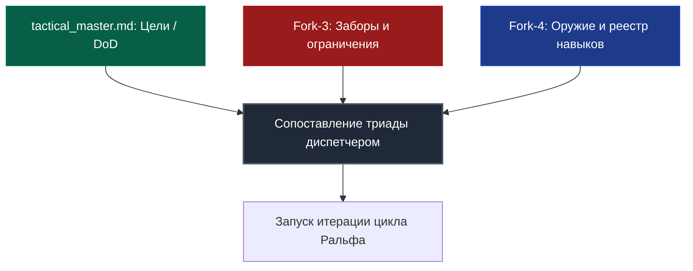
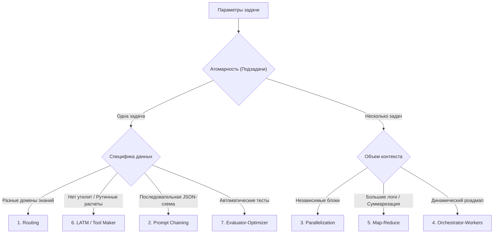

# Harness Protocol: Кибернетический контур управления автономными ИИ-агентами

[](https://opensource.org/licenses/Apache-2.0)
[](STRESS_TEST_REPORT.md)
[](#4-архитектура-памяти-и-экономика-токенов)

[English Version](README.md)

Добро пожаловать в спецификацию и референсную реализацию **Harness Protocol (Протокола Харнес)**. Этот протокол регламентирует строгое кибернетическое управление взаимодействием автономных ИИ-агентов с локальной файловой системой, компиляторами, средами выполнения и тестовыми пакетами.

---

## 1. Введение и базовая философия

При классической разработке с ИИ-агентами языковым моделям часто предоставляются неограниченные возможности выполнения команд и изменения файлов. Отсутствие структуры приводит к высокой вариативности логики, раздуванию контекста (bloat), регрессиям кодовой базы и угрозам безопасности.

Протокол Харнес решает эту проблему, рассматривая ИИ-агента не как самостоятельного разработчика, а как двухкомпонентную систему:

$$\text{Агент} = \text{Модель} + \text{Харнес}$$

- **Модель (LLM)** отвечает за рассуждения, выработку гипотез и принятие решений.
- **Харнес (Окружение)** создает изолированную песочницу, ограничивает выполнение инструментов, выступает в роли детерминированного гейта состояний и гарантирует абсолютную безопасность.

```
                  ┌────────────────────────────────────────┐
                  │                МОДЕЛЬ                  │
                  │  Рассуждения, планирование, кодинг     │
                  └───────────────────┬────────────────────┘
                                      │
                                 Формирует
                                      │
                                      ▼
                  ┌────────────────────────────────────────┐
                  │                ХАРНЕС                  │
                  │  Проверяет ограничения и состояния,   │
                  │  запускает компиляторы/тесты, судья    │
                  └───────────────────┬────────────────────┘
                                      │
                               Валидирует и
                                контролирует
                                      │
                                      ▼
                            [Рабочая кодовая база]
```

### Основные цели системы
1. **Безопасность и песочница:** Криптографическая и логическая гарантия того, что ИИ-агент не повредит хост-систему и не запустит неавторизованные действия.
2. **Детерминизм:** Ограничение вероятностных текстовых выводов модели жестким детерминированным контекстом выполнения (компиляторы, линтеры, тесты и строго фиксированные состояния).
3. **Принцип Храповика (Ratchet Principle):** Любая допущенная ИИ ошибка детально анализируется, каталогизируется, и для предотвращения ее повторения в проект встраивается новый тест или ограничение.

---

## 2. Архитектура системы и кибернетический контур

В начале любого рабочего цикла агент ограничен **Сопоставляющей Триадой** (Matching Triad):



1. **Цель задачи (Master):** Конечный критерий успешности выполнения (Definition of Done), записанный в паспорте задачи.
2. **Заборы (Constraints / Fork-3):** Жесткие ограничения на действия модели. Если модель пытается нарушить границу, выполнение блокируется на уровне скриптов, запуская цикл рефлексии.
3. **Оружие (Tools & Skills / Fork-4):** Рекомендованный арсенал инструментов (скрипты, MCP-серверы). Агент имеет право применять любые другие доступные в системе инструменты (если они не нарушают Fork-3), но обязан вносить успешные решения обратно в реестр Fork-4.

### Законы изоляции субагентов
- **Изоляция сессий:** Все субагенты запускаются в абсолютно свежих сессиях чата. Накопление истории из прошлых запусков или смежных задач строго запрещено.
- **Предварительная сборка контекста:** Контекст собирается диспетчером/скриптами и передается субагенту в первом же сообщении.
- **Внешний аудит:** Субагент-исполнитель никогда не проверяет собственный результат во избежание «подыгрывания» своим галлюцинациям. Все проверки осуществляются третьей стороной (компилятором или независимым ИИ-судьей).

---

## 3. Управляемый гейтами конечный автомат (State Machine)

Прохождение задачи под контуром Харнеса управляется жестким, не допускающим пропусков конечным автоматом, фиксирующим шаги в файле `.harness_state.json`.

```
 [awaiting_context] ─── contextAssembler --mode init/step ───► [context_served]
         ▲                                                            │
         │                                                        ИИ работает...
         │                                                            │
         │                                                contextAssembler --mode validate
         │                                                            │
         │                                                            ▼
         │                                                      [report_ready]
         │                                                            │
         │                                                   validator --type auto/ai/human
         │                                                            │
         │                                                            ▼
         │ ◄─── loopAdvancer --status SUCCESS ────────────────── [validated]
         │                                                            │
         │                                                     [SYNC_DUE] (проверка отклонений)
         │                                                            │
         │                                                       syncCheck.js
         ▼                                                            ▼
  [task_complete]                                             [awaiting_context]
```

### Детерминированные гейты
Эти гейты блокируют запуск следующих скриптов при неверной последовательности действий, возвращая код `GATE_FAILED`.

| Скрипт гейта | Гейт | Допустимое предыдущее состояние | Условие блокировки |
| :--- | :--- | :--- | :--- |
| `contextAssembler --mode validate` | **G1** | `context_served` | Блокирует, если `stage != "context_served"` |
| `validator.js` | **G2** | `report_ready` / `awaiting_subagent_validation` | Блокирует, если отсутствует отчет валидации |
| `loopAdvancer.js` | **G3** | `validated` | Блокирует, если узел не прошел валидацию |
| `contextAssembler --mode step` | **Drift** | `validated` / `sync_due` разрешено | Блокирует, если установлен флаг `sync_due` и сверка не выполнена |

### Схема файла состояния (`.harness_state.json`)
```json
{
  "task_id": "TACT-045",
  "stage": "context_served",
  "current_node": "NODE-02",
  "context_mode": "init",
  "context_served_at": "2026-07-10T18:30:00Z",
  "report_ready_at": null,
  "validated_at": null,
  "validation_type": "ai",
  "validation_result": null,
  "last_advanced_at": null
}
```

---

## 4. Архитектура памяти и экономика токенов

Протокол Харнес разделяет память на три независимых уровня выполнения. Эта структура позволяет удерживать контекстные окна агентов в компактном состоянии, экономя от **86% до 99%** объема токенов.

```
┌────────────────────────────────────────────────────────────────────────┐
│                      L3: СТРАТЕГИЧЕСКАЯ ПАМЯТЬ (Wiki)                  │
│       Официальные регламенты, архитектурные стандарты, база знаний.    │
│            Только для чтения. Изменяется с одобрения человека.        │
└───────────────────────────────────▲────────────────────────────────────┘
                                    │ (Апрув на публикацию / Human Gate)
┌───────────────────────────────────┴────────────────────────────────────┐
│                    L2: ТАКТИЧЕСКАЯ ПАМЯТЬ (Паспорт задачи)             │
│      Шестифайловая структура: план, заборы, логи, архивы.             │
│      Редактирование — только с помощью Node.js скриптов.               │
└───────────────────────────────────▲────────────────────────────────────┘
                                    │ (Компиляция и суммаризация)
┌───────────────────────────────────┴────────────────────────────────────┐
│                 L1: ОПЕРАТИВНАЯ ПАМЯТЬ (Буфер шага)                   │
│      Короткоживущие JSON-файлы с сухими фактами итераций шага.         │
│      Удаляются автоматически после закрытия узла роадмапа.             │
└────────────────────────────────────────────────────────────────────────┘
```

### Шестифайловая тактическая структура L2
Для исключения раздувания контекста тактическая память конкретной задачи делится на шесть изолированных файлов в каталоге `memory/tactical/`:

1. **Главный паспорт (`tactical_master.md`):** Паспорт задачи, исходное ТЗ, журнал вмешательства разработчика и общая матрица навигации.
2. **Управление циклом (Fork 1 / `forks/tactical_ralph_loop.md`):** План шагов (роадмап), лог итераций и критерии DoD. Генерируется из `.harness_roadmap.json`.
3. **Хроника (Fork 2 / `forks/tactical_work_log.md`):** Лог выполнения. Содержит **Warm Storage** (сухие выжимки закрытых узлов) и **Hot Storage** (последние 5 итераций активного узла).
4. **Заборы (Fork 3 / `forks/tactical_constraints.md`):** Статический реестр ограничений, собранный на этапе интервью.
5. **Оружие (Fork 4 / `forks/tactical_tools_registry.md`):** Доступные MCP-серверы, навыки и утилиты.
6. **Архив (Fork 5 / `forks/tactical_archive_dump.md`):** Свалка детальных логов закрытых шагов (Cold Storage). Заполняется скриптом `archiveNodeLog.js`.

### Правила экономики токенов
1. **Один вызов вместо чтения пяти файлов:** Агент никогда не читает L2-файлы вручную. Он запрашивает `contextAssembler.js --mode init\|step`, получая выжимку (например, вместо ~2100 токенов полного L2-пакета агент получает ~200-300 токенов).
2. **Автоматическое ведение логов:** Агент не редактирует Markdown-файлы вручную. Скрипт `loopAdvancer.js` сам обновляет и очищает структуру документов L2.
3. **Навигация без компаса:** Строки физических координат (например, `[Line 015] -> # заголовок`) предназначены для скриптов-парсеров. Агент изолирован от этой информации.
4. **Устойчивые якоря:** Все заголовки в документах предваряются скрытыми HTML-комментариями (например, `<!-- ANCHOR: ID -->`). Скрипт `reindexTactical.js` пересчитывает координаты навигации именно по этим якорям, не ломая разметку при редактировании текста.
5. **Обход тривиальных задач:** Если задача решается за $\le 2$ шага, инициализация L1/L2 отключается. Результат сразу пишется в `walkthrough.md`.

---

## 5. Универсальная перекрестная валидация (Cross-Validation) и внешние ИИ-судьи

### Запрет на самовалидацию
**ИИ-агент, выполняющий задачу, категорически не имеет права выносить вердикт по своей работе.** Любое закрытие шага должно быть подтверждено компилятором/тестами (`auto`), действиями разработчика (`human`) или независимой внешней языковой моделью (`ai`).

```
                ┌──────────────────────────────────────┐
                │             Исполнитель              │
                │        пишет код и артефакты         │
                └──────────────────┬───────────────────┘
                                   │ (Evidence Diff)
                                   ▼
                 ┌───────────────────────────────────┐
                 │       Независимый ИИ-Судья        │
                 │   - Изолированная свежая сессия   │
                 │   - Валидирует по жесткой рубрике │
                 │   - Выдает строгий JSON-вердикт   │
                 └───────────────────────────────────┘
```

### Три типа валидации
1. **`auto` (Детерминированный):** Сборка кода, прохождение линтеров или выполнение unit-тестов (NUnit, npm test). Результат оценивается по коду возврата (exit code).
2. **`ai` (Внешний ИИ-судья):** Запускается через транспорт `cliTransport.js`.
   - Анализирует переданные улики (evidence): для `artifact_kind=code` — `git diff HEAD`, для `text` — сгенерированные текстовые файлы.
   - Обязательно возвращает структурированный JSON с цитированием улик:
     ```json
     { "pass": true, "dod_results": { "C1": true }, "evidence": ["строка-улика из текста"] }
     ```
3. **`human` (Разработчик):** Харнес приостанавливает работу, генерирует сводный файл `validation_report.md` и ждет команду `--approve` или `--reject` от разработчика.

### Защита и отказоустойчивость судей
- **Цепочка судей:** CLI-вызовы проверяются последовательно (первый живой побеждает) по цепочке из `harness.config.json` (например, `agy → claude → codex`).
- **Проверка авторизации F1:** Скрипт `aiProbe.js` шлет судьям случайный одноразовый код (nonce). Если CLI возвращает ошибку авторизации (например, "IneligibleTier" или "Not logged in"), этот судья временно помечается оффлайн, исключая зависания по тайм-ауту.
- **Оптимизация детерминированного оракула (L0 Bypass):** Если для шага `ai` задана тестовая команда `--cmd` или уровень критичности определен как L0, скрипт валидирует работу исключительно детерминированными средствами (компилятор, тесты, линтер), пропуская вызов дорогого ИИ-судьи для экономии токенов и ускорения работы.
- **Кросс-семейный отбор и правило F5:** Выбор ИИ-судьи регулируется скриптом `judgeSelector.js`. Главное правило — **судья должен принадлежать к иному семейству моделей, чем воркер** (same-family PASS строго запрещен). Например, если исполнителем (worker) был Claude (семейство `anthropic`), субагент-судья на базе Claude отклоняется, а статус узла сбрасывается в `UNVALIDATED` (не переходит в `PASS`), требуя подключения независимого CLI-судьи (`agy`/`gemini` или `codex`/`gpt`).
- **Резервный субагент (Subagent-Fallback):** Если все внешние CLI-судьи отключены, валидатор переходит к стадии резервного субагента, но только если воркер принадлежит к другому семейству моделей.
- **Автоматическое восстановление JSON и повторные попытки:** AI-валидатор делает до 2 попыток вызова судьи при сетевых сбоях. При получении текстовых ответов с невалидным JSON функция `tryFixJson` пытается автоматически исправить синтаксические ошибки (пропущенные кавычки, лишние запятые) или извлечь вердикт с помощью регулярных выражений.

### Ровно три обязательных ручных гейта (Human Gates)
Агент заблокирован в режиме «только чтение». Вмешательство человека требуется строго в 3 случаях:
1. **Публикация в базу знаний:** Внесение регламентов/Gotchas из тактической памяти L2 в глобальный Wiki-архив L3.
2. **Запись в Git:** ИИ не имеет права делать коммиты, пушить или создавать ветки без явной команды в чате.
3. **Эскалация (CRITICAL_FAIL):** При исчерпании лимита итераций или неразрешимости забора ограничений. Агент формирует **Отчет о недостижимости** (Unreachability Report) и прекращает работу.

---

## 6. Цикл Ральфа (Ralph Loop) и 7 ИИ-стратегий

Все задачи разделены по типу создаваемых артефактов (`artifact_kind`):
- **`code` (код):** Выполняется агентом среды разработки (IDE) непосредственно в дереве проекта.
- **`text` (текст/документы):** Может выполняться автономным движком `strategyEngine.js`.

При обработке узла Диспетчер рассчитывает характеристики атомарности задачи и предсказуемости результатов, выбирая одну из **7 стратегий**:



### Справочная таблица стратегий

| Стратегия | Атомарность | Предсказуемость | Сфера применения / Специфика |
| :--- | :---: | :---: | :--- |
| **1. Prompt Chaining** | 1 | Высокая | Линейные преобразования, переводы, написание доков по жестким JSON-схемам. |
| **2. Routing** | 1 | Средняя | Классификация доменов (перенаправление специализированным агентам UI, Звука или Логики). |
| **3. Parallelization** | >1 | Средняя | Независимый аудит файлов кодовой базы, параллельный сбор документации. |
| **4. Orchestrator-Workers** | >1 | Низкая | Разработка сложных систем «под ключ», автоисправление компиляции на лету. |
| **5. Map-Reduce** | >1 | Высокая | Разбор гигантских логов ошибок, категоризация дампов памяти. |
| **6. LATM / Tool Maker** | 1 | Низкая | Создание локальных Node.js/Python скриптов для решения рутинных вычислений. |
| **7. Evaluator-Optimizer** | 1 | Выш.средней | Написание алгоритмов, исправление ошибок компиляции до упора. |

### Уровни моделей и каскадный фоллбек
Модели делятся на абстрактные уровни: `frontier`, `advanced`, `medium`, `light`. При сбоях или исчерпании лимитов на уровне провайдеров Диспетчер автоматически подменяет модели внутри текущего тира, переходит на уровень выше или спускается до локальных бесплатных моделей (`light`) для разбора логов.

---

## 7. Защита от отклонений (Drift-Guard) и синхронизация со спецификацией

При длительных циклах разработки ИИ-агенты склонны постепенно уводить реализацию от исходных архитектурных рамок. Для предотвращения этого работает **Drift-Guard**:

```
[Закрытые узлы роадмапа] == sync_interval (по умолчанию: 4)
                       │
                       ▼
            Состояние: SYNC_DUE
                       │
                       ▼
           Блокировка выдачи контекста
                       │
                       ▼
        Запуск syncCheck.js (Внешний ИИ)
                       │
             ┌─────────┴─────────┐
             ▼                   ▼
       [CONTINUE]       [REQUIRE_CORRECTION]
             │                   │
      Снятие лока и      Добавление корректирующего
      сброс счетчика     узла роадмапа, выполнение
                         и вызов --acknowledge
```

- **`CONTINUE` (продолжить):** Сверка успешна, реализация совпадает с целями. Блокировка снимается.
- **`REQUIRE_CORRECTION` (нужна правка):** Зафиксировано отклонение от ТЗ. Скрипт `roadmapEdit.js` вставляет новый корректирующий узел в роадмап. Выполнение остальных задач блокируется до исправления отклонения.

---

## 8. Справочник скриптов и шпаргалка CLI

Все скрипты управления находятся в папке `Scripts/`.

| Скрипт | Аргументы | Роль | Результат выполнения |
| :--- | :--- | :--- | :--- |
| `task_initializer.js` | `<task_id> "<task_title>"` | Создает базовую структуру паспорта и L2-директории задачи. | Создает скелет в `memory/tactical/<task_id>/`. |
| `roadmapEdit.js` | `<task_dir> <action> [options]` | Редактирует узлы в `.harness_roadmap.json`. Действия: `add-node`, `set-status`, `set-dod`, `set-field`, `set-current`, `set-config`, `list`. | Обновляет JSON и генерирует Markdown роадмапа. |
| `contextAssembler.js` | `<task_dir> --mode <init\|step\|status\|validate>` | Собирает оптимизированный контекст для ИИ-агента или генерирует отчет. | Вывод JSON в консоль или создание `validation_report.md`. |
| `validator.js` | `<task_dir> --node <node_id> --type <auto\|ai\|human> [options]` | Запускает проверку выполнения критериев узла. | Меняет стадию в файле состояния на `validated`. |
| `loopAdvancer.js` | `<task_dir> --node <node_id> --status <SUCCESS\|FAIL> [options]` | Обновляет тактический статус узла, записывает инсайты, двигает цикл. | Возвращает JSON со следующей операцией цикла. |
| `syncCheck.js` | `<task_dir> [--acknowledge]` | Сравнивает текущие изменения проекта с целями исходного ТЗ. | Снимает блокировку отклонений или заставляет внести правку. |
| `cli-judge.js` | `--file <path> [--worker-family <family>]` | Ручной запуск цепочки внешних ИИ-судей для проверки кода или текста. | Выводит текстовый вердикт PASS/FAIL. |
| `reindexTactical.js` | `<task_dir>` | Пересчитывает физические строки навигационной матрицы в документах L2. | Переписывает заголовок `tactical_master.md`. |
| `aiProbe.js` | `[--force]` | Тестирует доступность и валидность авторизации внешних ИИ-судей. | Сохраняет статус в `.harness/ai_probe.json`. |

---

## 9. Пошаговые сценарии работы и частые команды

### Инициализация новой крупной задачи
```powershell
# 1. Создаем структуру тактической памяти
node Scripts/task_initializer.js TACT-045 "Интеграция кастомной авторизации"

# 2. Добавляем узлы роадмапа
node Scripts/roadmapEdit.js memory/tactical/TACT-045 add-node --id NODE-01 --title "Проектирование контрактов интерфейса" --validation auto --kind code --dod "Код контракта компилируется без ошибок"
node Scripts/roadmapEdit.js memory/tactical/TACT-045 add-node --id NODE-02 --title "Реализация AES-GCM шифрования" --validation ai --kind code --dod "Шифрование проходит ревью ИИ-судьи"

# 3. Перестраиваем индекс матрицы навигации
node Scripts/reindexTactical.js memory/tactical/TACT-045

# 4. Останавливаемся и ждем ручной команды разработчика в чате: "Реализуй план"
```

### Выполнение узла в цикле Ральфа
```powershell
# 1. Запрашиваем контекст шага (переводит стейт-машину в состояние context_served)
node Scripts/contextAssembler.js memory/tactical/TACT-045 --mode init

# [ИИ выполняет изменения файлов в рабочей кодовой базе]

# 2. Генерируем отчет валидации
node Scripts/contextAssembler.js memory/tactical/TACT-045 --mode validate --node NODE-01

# 3. Запускаем автоматическую валидацию (срабатывает компилятор/тесты)
node Scripts/validator.js memory/tactical/TACT-045 --node NODE-01 --type auto --cmd "dotnet build"

# 4. Двигаем цикл Ральфа вперед
node Scripts/loopAdvancer.js memory/tactical/TACT-045 --node NODE-01 --status SUCCESS --insight "Успешно собрана заглушка интерфейсов авторизации"

# 5. Переходим к следующему узлу роадмапа
node Scripts/contextAssembler.js memory/tactical/TACT-045 --mode step
```

---

## 10. Гарантия качества и регрессионное тестирование

Протокол Харнес поставляется с полным покрытием автоматическими проверками.

- **Unit-тесты:** Проверяют переходы стейт-машины, блокировку некорректных вызовов и лимиты CLI-транспорта.
- **Стресс-тесты:** Запускают виртуального агента по длинному роадмапу, эмулируя падения, срабатывание проверок Drift-Guard и откаты изменений.
- **Smoke-тесты:** Гарантируют нерушимость гейтов жизненного цикла.

Для проверки работоспособности всех механизмов выполните:
```powershell
node Scripts/smoke/run.js
```
Все проверки должны завершиться со статусом PASS.

```
======================================
     HARNESS PROTOCOL SMOKE TEST
======================================
[INFO] Running 24 integration tests...
[PASS] Sandbox paths resolution (independent cwd)
[PASS] report_ready gate (prevent pre-context validation)
[PASS] validated gate (prevent pre-validation loop advancement)
[PASS] cliTransport large buffer diffs (no ENAMETOOLONG)
[PASS] Drift-guard soft lock and node replication
...
[RESULT] 24/24 validations completed successfully.
======================================
```
Подробные отчеты замеров латентности и экономии токенов находятся в файле [Stress Test Report](STRESS_TEST_REPORT.md).

---

## 11. Последние обновления и нововведения (v2)

### 1. Защитный гейт F5 и строгое кросс-семейное правило
Для обеспечения объективности валидации введен **абсолютный запрет на самовалидацию и валидацию моделями одного семейства**:
* Исполнитель задачи (воркер) **не может** оцениваться судьей из того же семейства моделей.
* Например, если код писал Claude (семейство `anthropic`), то судьей не может выступать ни Claude, ни субагент на его базе. Валидировать его работу должен представитель другого семейства — Google (`gemini`/`agy`) или OpenAI (`gpt`/`codex`).
* В случае отсутствия активных кросс-семейных судей статус узла сбрасывается в `UNVALIDATED` (вместо ложного `PASS`), что блокирует дальнейшее продвижение по циклу до тех пор, пока разработчик не подключит подходящую независимую модель.

### 2. Динамический выбор судей (`judgeSelector.js`)
Реализован изолированный чистый алгоритм выбора судей на основе характеристик задачи:
* **Уровни критичности узлов (Criticality Levels)**:
  * **L0 (Trivial/Predefined)**: Механические изменения. Проверяются только детерминированными оракулами (линтер, компилятор, тесты). ИИ-судья не вызывается.
  * **L1 (Standard)**: Оценивается одним *medium* кросс-семейным судьей.
  * **L2 (Important)**: Оценивается одним *strong* кросс-семейным судьей.
  * **L3 (Critical)**: Оценивается *кворумом* из 2 сильных судей разных семейств. Если активен только один судья, запускается режим **dual-order** (оценка одной и той же улики в разном порядке следования).
* **Артефактное соответствие**: Модели оцениваются по их предрасположенности к задачам: для кода (`code`) приоритет отдается OpenAI (`codex`), для текстов/спецификаций (`text`) — Anthropic (`claude`).

### 3. Доктрина тиров моделей (Model-Tier Doctrine)
Все роли жестко распределены по тирам возможностей для снижения расходов токенов без потери качества:
* `worker` по умолчанию использует дешевые модели (`cheap`).
* `judge` по умолчанию использует средние модели (`medium`).
* `evaluator` по умолчанию использует сильные модели (`high`).
* `reasoner` и `researcher` используют максимальные модели (`max`).
* `manager` (интерактивный цикл с человеком) использует топовые модели (`top`).

### 4. Повышение стабильности и авто-исправление JSON
* **Повторные попытки**: При временных сбоях сети или API валидатор делает до 2 попыток повторного вызова судьи.
* **Авто-исправление JSON (`tryFixJson`)**: ИИ-судьи часто возвращают прозу вокруг JSON-блока или допускают мелкие ошибки (запятые, отсутствие кавычек у ключей). Валидатор автоматически нормализует и парсит такой вывод, а при полной поломке использует регулярные выражения для извлечения полей `pass` и `errors`.

