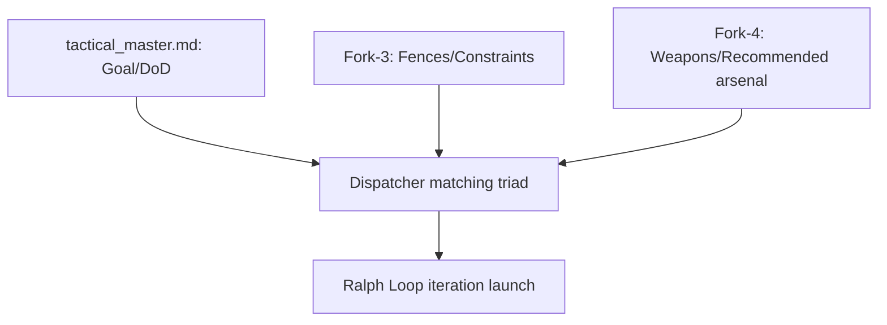
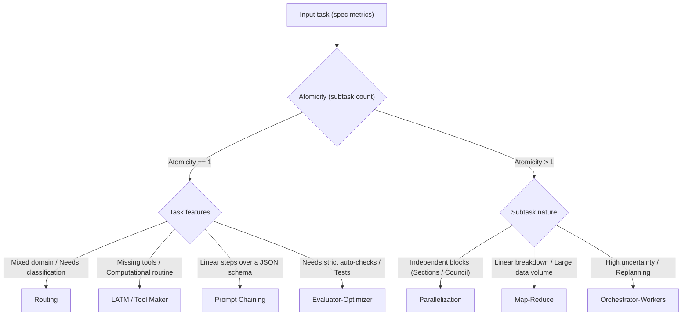
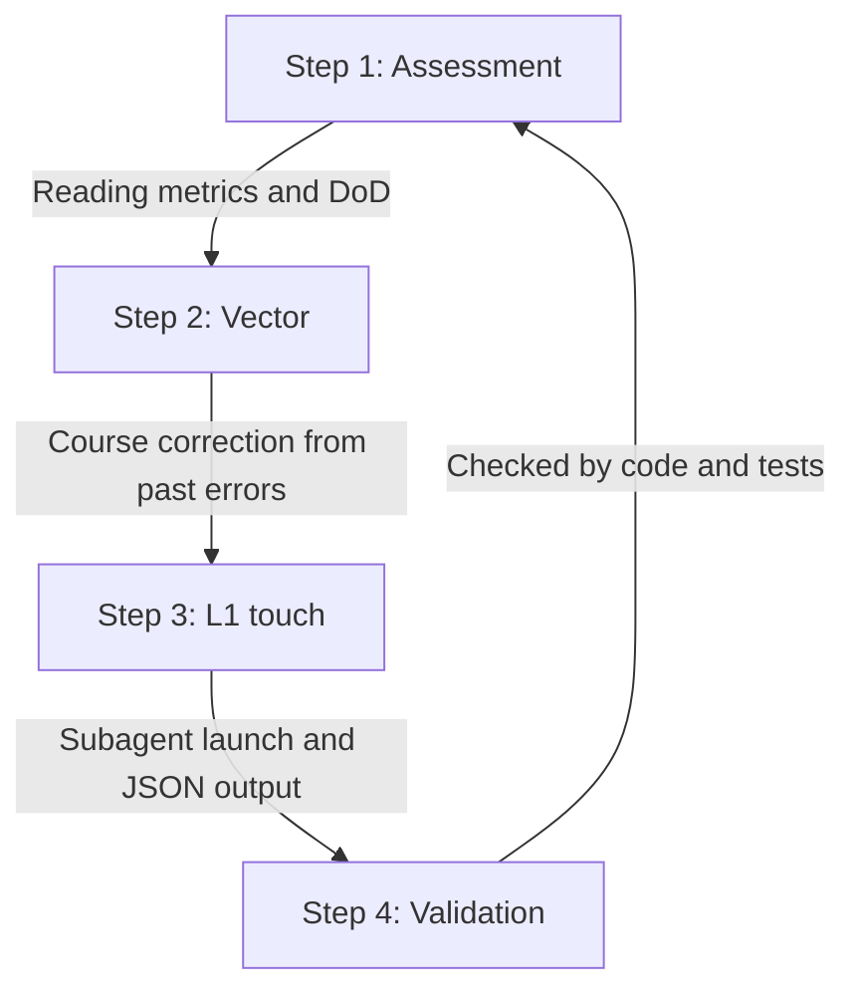

# 🔄 Ralph Loop Rules and Regulation (Ralph Loop Principles)

This document defines the rules, structure, and cybernetic principles of the **Ralph Loop** within the Harness system for controlling autonomous AI agents.

<!-- ANCHOR: CYBERNETIC_LOOP -->
## 1. Cybernetic contour principle (fork interaction)

Before starting any loop iteration, the AI Dispatcher must perform the **matching triad** of resources and constraints to ensure safety and predictability:

1. **Task goal (Goal):** extracted from the Master document (`tactical_master.md`). Defines the final success criterion (Definition of Done).
2. **Fences (Constraints):** read from[Fork-3 (Constraints)](tactical-memory-spec.md)) (Component D). These are the hard boundaries of what is allowed (architecture standards, forbidden libraries, network isolation). If a constraint boundary is crossed, the AI Dispatcher initiates a reflection cycle: analyzes the cause, corrects the vector on the next iteration, and tries to fix the behavior. Emergency stop (`CRITICAL_FAIL`) happens only when the constraint cannot be worked around after the reflection iteration limit is exhausted.
3. **Weapons (Tools & Skills):** read from **Fork-4 (Tools & Skills)**. This fork is a **recommended but not exhaustive** registry of the agent's tools (MCP servers, scripts, specialized CLIs).
   * *Extension right:* the agent has full right to use any other tools available in the environment as long as they do not violate the hard constraints of Fork-3. On successfully applying a new tool, the agent must record its description, launch parameters, and signature into Fork-4, expanding the "arsenal" for later iterations and other agents.



### Subagent isolation and validation principles

To prevent context degradation and cognitive bias in subagent work, the AI Dispatcher must strictly follow three system laws:

1.  **Session isolation (Clean Start):** every subagent always starts its work from a new, absolutely clean chat (session). Accumulating history from previous runs or adjacent tasks is strictly forbidden.
2.  **Pre-context assembly (Context Assembly):** before starting a subagent, the Dispatcher/Harness assembles the full context with all the information needed for the task (spec excerpt, Fork-3 constraints, Fork-4 tools/skills, source code) and passes it to the subagent in the first message.
3.  **External Verification:** all checks of a subagent's results are performed strictly by a **third party** — a deterministic automatic script (compiler, unit tests) or a **completely different** independent evaluator subagent. The executor subagent is categorically forbidden to validate its own results, to avoid "playing along" with its own hallucinations and hidden defects. An external LLM judge is a fully valid evaluator at any stage; only self-validation is forbidden.

<!-- ANCHOR: WORKFLOW_STRATEGIES -->
## 2. Work organization strategies (decision mathematics)

The AI Dispatcher must choose the optimal strategy for each node of the tactical roadmap. The choice is based on two metrics: **Result predictability (0-100%)** and **Number of subtasks (Atomicity)**. Instead of a one-size-fits-all approach, the Dispatcher classifies the task into one of 7 types and applies the corresponding regulation.

### Strategy Selection Matrix (default)

To make the choice deterministic, the AI Dispatcher must match the current task parameters against the following mathematical and logical boundary conditions.



#### Selection boundary conditions

| Strategy | Input parameters (boundary conditions) | Domain / Features |
| :--- | :--- | :--- |
| **Prompt Chaining** | Atomicity = 1, linear step dependencies over a JSON schema | All domains. Splitting complex context into isolated steps. |
| **Routing** | Atomicity = 1, mixed requirements, heterogeneous domains (UI, Audio, Logic) | Dispatching to specialized workers/skills. |
| **Parallelization** | Atomicity > 1, independent blocks (Sectioning) or a council need (Voting) | Parallel code audit, bulk documentation. |
| **Orchestrator-Workers** | Atomicity > 1, high step uncertainty, dynamic dependencies | Developing complex modules with on-the-fly replanning. |
| **Map-Reduce** | Atomicity > 1, extremely large data volumes (Big Data), independent parts | Log analysis, bulk refactoring, summarization. |
| **LATM / Tool Maker** | No ready-made utilities, computational task nature | Generating Node.js/Python scripts in the sandbox for routine work. |
| **Evaluator-Optimizer** | Absolute precision needed, an automatic linter/tests/compiler exists | Iterative code-fixing loop under deterministic control. |

#### Override Protocol
The AI Dispatcher may deviate from the default selection matrix when two conditions are met:
1. The chosen alternative strategy passes the Fork-3 constraints better or uses the Fork-4 tools more effectively.
2. The technical justification for the substitution is explicitly recorded in the current iteration's tactical log (`forks/tactical_ralph_loop.md`) in the **"Iteration hypothesis"** or **"Reflection vector"** field. *Example: "The matrix requires Map-Reduce, but since Fork-4 lacks a ready JSON merge script, overriding to Orchestrator-Workers."*

### AI model capability tiers

Model selection is driven by abstract capability tiers, not hardcoded model names. The tier-to-model mapping is maintained **exclusively** in [`Scripts/llm-config.json`](../../../Scripts/llm-config.json):

* **`capability_tiers`** — the list of concrete models per tier: `frontier` (top reasoning models), `advanced` (expert models), `medium` (balanced models), `light` (lightweight/free/local models). Update the config, not this document, when models change.
* **`strategy_role_tiers`** — the recommended minimum tier per role for each of the 7 strategies (see below).

Do not write concrete model names into protocol documents: they rot quickly. Reference tiers and roles instead.

---

### Cascading Model Fallback Protocol

On API errors (rate limit, 5xx server errors, connection timeout, quota exhaustion, or account lock) the AI Dispatcher must follow the strict switching algorithm:
1.  **In-tier rotation:** first the Dispatcher tries an alternative model inside the current tier (per `capability_tiers` in `llm-config.json`).
2.  **Upward cascade:** if all models of the current tier are unavailable, the Dispatcher moves up to higher-tier models (e.g. from `medium` to `advanced`, from `advanced` to `frontier`) searching for the minimal workable and currently available option.
3.  **Local/free reserve:** if external commercial APIs are fully unavailable, the Dispatcher switches to the local `light` tier pool for basic routines (compilation, log parsing), while complex architectural or algorithmic steps are suspended until connectivity is restored.

For the external judge (type `ai` validation) a separate binary chain `cli_transport.judge_chain` applies — see[current-implementation.md](current-implementation.md)).

---

### Regulation of the 7 allowed loop-control strategies

The AI Dispatcher must choose one of the 7 allowed control strategies for each tactical roadmap step. Below is a detailed description of each strategy: its rules, configuration, application, subagent distribution, plus validation, data aggregation, and reflection methodology. Recommended role tiers reference `strategy_role_tiers` in [`Scripts/llm-config.json`](../../../Scripts/llm-config.json).

---

#### Strategy 1: Prompt Chaining

1.  **Principle, rules, and settings:**
    Sequential execution of a series of steps where the output of the previous model is fed to the next one. This decomposes a complex cognitive task into a linear sequence of simpler isolated instructions over a strictly defined JSON schema.
    *   *Settings:* every step uses a strictly dedicated prompt. Where the runtime allows temperature control, use a low temperature (~0.1) for analysis and code-writing steps to reduce variance. Intermediate step results are stored in temporary operational memory (`op_memory.json`).
    *   *Rules:* merging chain steps into a single request is forbidden, even if they look simple. Every step must output structured JSON.
2.  **Task classes and examples:**
    Linearly dependent medium-complexity tasks that need stepwise reasoning but no backtracking or dynamic planning.
    *   *Stepwise component development:* Step 1: read the spec and draft the interface $\rightarrow$ Step 2: implement the class per the interface $\rightarrow$ Step 3: write the unit test.
    *   *Documentation and review:* Step 1: extract the public method structure from code $\rightarrow$ Step 2: generate the API markdown document $\rightarrow$ Step 3: lint internal links.
    *   *Localization conversion:* Step 1: extract raw text from the UI $\rightarrow$ Step 2: machine-translate with a context dictionary $\rightarrow$ Step 3: assemble the final localization JSON file.
    *   *Example:* creating a C# class `AppPromoBridge.cs` from a spec: the Dispatcher first extracts requirements, then generates method stubs, then fills in the logic.
3.  **Minimum role tiers:** chain analyst/planner (first steps) — tier `medium`; coder/executor (subsequent steps) — tier `medium`.
4.  **Task signs, special conditions, and notes:**
    *   *Signs:* the task has a clear stepwise algorithm, but its full description and context overload the model's attention window in a single request.
    *   *Special conditions:* if the validator detects an error at step N, the chain rolls back to step N-1, adding the error description to the context for regeneration.
5.  **Validation, checking, and reflection:**
    *   *Checking methodology:* stepwise control at every chain joint. The output JSON of link N must strictly match the expected JSON schema (JSON Schema validation) before being passed to link N+1.
    *   *Reflection mechanism:* if link N produces an error or malformed output, a pointwise reflection step runs: the Harness restarts exactly that link, feeding it the validation error message and the log. Up to 2 local fix attempts are allowed. If they fail, the whole chain stops and switches to emergency mode or orchestration.
6.  **Harness integration spec (I/O, limits, skills):**
    *   *I/O spec:* a single L1 file `op_memory.json`. Every sequence step writes strictly into the `iteration_output` field of its step in the `iterations` array. Overwriting previous step results is forbidden.
    *   *Limits and exit conditions:* up to 2 restart attempts per link. On final failure the chain is interrupted and control passes to `Orchestrator-Workers` for a dynamic workaround.
    *   *Subagent and skills:* planner (tier **medium/advanced**), executors (tier **medium/advanced**). Skills: `view_file`, `replace_file_content`.

---

#### Strategy 2: Routing

1.  **Principle, rules, and settings:**
    Classification of the incoming request by the Dispatcher-router and its redirection to a specialized executor (prompt or subagent) with a narrowed context.
    *   *Settings:* the router is configured for minimal variance (temperature 0.0 where available) using Structured Outputs for reliable classification. Executor branches are configured independently.
    *   *Rules:* the router must operate on a strictly fixed category list and must not do any substantive work on the task itself — its role is dispatching only.
2.  **Task classes and examples:**
    Multi-profile incoming tasks containing requests from radically different domains, or tasks requiring narrowly specialized system skills.
    *   *Mixed development tasks:* splitting into game-logic, UI (MVP), and media-integration (sounds, animations) domains.
    *   *System PR review:* dispatching code to a memory-leak check (UniTask agent), code-style check (C# Style agent), or dependency check (DI agent).
    *   *Example:* for the task "Integrate the promo screen with a button sound," the Router sends the UI-MVP part to the `unity-ui-mvp-builder` subagent, and the audio effects to `kbpro-audio-builder`.
3.  **Minimum role tiers:** router (dispatcher-classifier) — tier `advanced`; profile worker-executors — tier `medium` (code and logic) / `medium` (texts, localizations, audio configs).
4.  **Task signs, special conditions, and notes:**
    *   *Signs:* the request simultaneously contains requirements for different subsystems (e.g. "write a shader and add a sound").
    *   *Notes:* routing significantly saves tokens and improves quality because it keeps irrelevant system instructions out of a single model's context.
5.  **Validation, checking, and reflection:**
    *   *Checking methodology:* validating the route itself (the router's Structured Output must match the category list) and independently validating results in the final target branches (per those branches' regulations).
    *   *Reflection mechanism:* if the final executor in the chosen branch returned an error, the Router reflects: analyzes the error log and decides — send the task down an alternative path (e.g. if the UI code harness failed due to missing data, redirect to the logic worker) or request extra context from the Dispatcher.
6.  **Harness integration spec (I/O, limits, skills):**
    *   *I/O spec:* reads the input request from `op_memory.json`. Writes the routing decision to `op_route.json` (JSON with the selected worker type). The data is then forwarded into the selected branch's input file (e.g. `op_ui_task.json`).
    *   *Limits and exit conditions:* route reselection — at most once, on clear worker/task incompatibility. On a repeated failure — interruption into `CRITICAL_FAIL`.
    *   *Subagent and skills:* router-classifier (tier **advanced/frontier**). Skills: `router_classifier` (based on Structured Outputs).

---

#### Strategy 3: Parallelization

1.  **Principle, rules, and settings:**
    Parallel launch of several independent models for simultaneous processing of task parts (Sectioning) or generating alternative solutions (Voting) with automatic result merging.
    *   *Settings:* worker requests are sent asynchronously with low variance for Sectioning and higher variance for Voting (to get a spectrum of solutions). The collator aggregates results with minimal variance.
    *   *Rules:* workers must not know about each other's existence. Their contexts must be fully isolated.
2.  **Task classes and examples:**
    Large divisible tasks without cross data dependencies, or tasks with elevated fault-tolerance and verification-quality requirements.
    *   *Sectioning:* simultaneous documentation of 15 project classes, parallel refactoring of independent files in different folders.
    *   *Voting (Council):* generating regular expressions with three models in parallel to choose the most stable variant passing all unit tests.
    *   *Multi-aspect audit:* parallel launch of three agents on the same file to find: 1) logical vulnerabilities, 2) memory allocations in Update methods, 3) UniTask leaks.
    *   *Example:* bulk generation of reference files for new promo-system C# modules by five parallel workers.
3.  **Minimum role tiers:** parallel workers — tier `light`/`medium`; collator/result aggregator — tier `frontier`.
4.  **Task signs, special conditions, and notes:**
    *   *Signs:* the task splits easily into independent blocks (file arrays, independent functions); result assembly requires no logical conflict resolution.
    *   *Notes:* requires a reliable program harness (Node.js/Python scripts) for parallel HTTP dispatch and timeout error handling.
5.  **Validation, checking, and reflection:**
    *   *Checking methodology:* two check levels: 1) local validation of each individual worker's results; 2) global validation of the aggregated result (by the collator) for logical integrity and absence of duplicates/conflicts.
    *   *Reflection mechanism:*
        *   *Sectioning:* if one worker failed, the Harness isolates its task and reruns it with clarified context.
        *   *Voting:* if opinions split and no consensus is reached, the Aggregator reflects over all proposed variants, identifies the collision, and either decides on a `frontier`-tier model or hands the disputed task to rework in a new isolated session.
6.  **Harness integration spec (I/O, limits, skills):**
    *   *I/O spec:* each parallel worker writes strictly into its own JSON file of the form `op_task_part_[ID].json` (e.g. `op_task_part_1.json`). The collator reads this file array and forms the final `op_memory.json`. Workers are forbidden to overwrite each other's files.
    *   *Limits and exit conditions:* worker attempt limit — 2. In `Sectioning` mode a single worker's failure leads to `CRITICAL_FAIL` (after retries). In `Voting` mode the decision is made by majority.
    *   *Subagent and skills:* workers (tier **medium**), collator (tier **advanced/frontier**). Skills: `json_array_aggregation` (automatic JSON merging without LLM involvement).

---

#### Strategy 4: Orchestrator-Workers

1.  **Principle, rules, and settings:**
    A complex iterative pattern where a central model (the Orchestrator) dynamically decomposes the task, builds an action plan, delegates subtasks to specialized executors (Workers), evaluates their results, and corrects the global roadmap on the fly.
    *   *Settings:* the Orchestrator runs with minimal variance to keep focus on goals and strict roadmap control. Workers are configured per their specialization.
    *   *Rules:* the Orchestrator must persist state into L1 operational memory (`op_memory.json`) after every worker response, to prevent looping on failures.
2.  **Task classes and examples:**
    Complex engineering tasks with high uncertainty, where the final algorithm depends on intermediate step results.
    *   *Turnkey game-module development:* the Orchestrator designs the structure, calls a worker for logic code, then a worker for UI, then runs the compiler, analyzes error logs, and sends the code back to workers for rework.
    *   *System migration to a new framework:* API-difference analysis, stepwise dependency updates, cascading build-error fixes.
    *   *Example:* orchestrating the integration of the `kbpro_promo_module` submodule with generation of the `AppPromoBridge.cs` bridge and autotests.
3.  **Minimum role tiers:** orchestrator (the system brain) — strictly tier `frontier`; workers (codegen, log parsing) — tier `medium` minimum.
4.  **Task signs, special conditions, and notes:**
    *   *Signs:* the plan has > 5 steps, not all compilation/test errors can be predicted upfront, interactive interaction with the runtime environment is required.
    *   *Notes:* this is the most token-expensive pattern. To reduce cost the Orchestrator must pass workers only the strictly necessary part of the task context.
5.  **Validation, checking, and reflection:**
    *   *Checking methodology:* comprehensive dynamic validation. The Orchestrator checks DoD fulfillment at every roadmap stage, running autotests and the project build in the sandbox after worker commits.
    *   *Reflection mechanism:* deep contextual reflection. On worker errors the Orchestrator does not just rerun them — it modifies the worker's prompt task, attaching the compiler stack trace and Wiki excerpts. If a worker makes 3 unsuccessful fix attempts, the Orchestrator reflects over the global plan: changes the architectural approach or re-decomposes the task.
6.  **Harness integration spec (I/O, limits, skills):**
    *   *I/O spec:* state and plan live in `op_memory.json` (L1). The Orchestrator issues tasks via `op_worker_task_[ID].json`. Workers write reports into `op_worker_result_[ID].json`. The Orchestrator reads them and updates the master plan in `op_memory.json`.
    *   *Limits and exit conditions:* plan step limit — up to 15. Up to 3 fix attempts per specific worker. On limit exhaustion the Orchestrator performs Dynamic Replanning with an `op_memory.json` update.
    *   *Subagent and skills:* orchestrator (tier **frontier**), workers (tier **medium/advanced**). Skills: `kbpro-code-navigator` (code analysis), `run_command` (compilation and tests).

---

#### Strategy 5: Map-Reduce

1.  **Principle, rules, and settings:**
    Hierarchical processing of extremely large information volumes. The task is split into many independent fragments processed in parallel (Map), after which the results are hierarchically merged and summarized into a final report (Reduce).
    *   *Settings:* the Map stage favors precision (low variance) for data extraction; Reduce stages favor structuring and summarization.
    *   *Subagents and documents:* $M$ first-level workers (Map) write into `op_map_data_M.json`. $R$ second-level workers (Reduce) aggregate results by group into `op_reduce_group_R.json`. The final coordinator forms `op_reduce_final.json`.
2.  **Task classes and examples:**
    Big-data analysis, summarization of giant documentation/log/codebase volumes, bulk refactoring of hundreds of independent files.
    *   *Example:* writing a single analytical report over 100 MB of weekly game crash dumps with categorization across 20 subsystems.
3.  **Minimum role tiers:** Map workers (primary processing) — tier `medium` (for token economy); Reduce aggregators — tier `advanced`; final aggregator — tier `frontier`.
4.  **Task signs, special conditions, and notes:**
    *   *Signs:* the data volume exceeds a single model's context window or limits; fragments are fully independent at the Map stage.
    *   *Switching to other strategies:* if the reduction fails due to logical collisions in worker results, the problematic group switches to **Prompt Chaining** for stepwise linear breakdown, or control passes to **Orchestrator-Workers**.
5.  **Validation, checking, reflection, and artifact assembly:**
    *   *Artifact assembly:* the final summarized file `op_reduce_final.json` is copied into `op_memory.json`.
    *   *Checking and reflection methodology:* completeness check (make sure no source fragment was lost during reduction). Reflection records the number of reduction levels and the stability of information compression.
6.  **Harness integration spec (I/O, limits, skills):**
    *   *I/O spec:* $M$ first-level (Map) workers write into `op_map_data_M.json`. $R$ second-level (Reduce) workers aggregate group results into `op_reduce_group_R.json`. The final coordinator forms `op_reduce_final.json`.
    *   *Limits and exit conditions:* Map workers get up to 2 attempts per fragment on failure. A final assembly failure (collisions) switches the task to `Orchestrator-Workers`.
    *   *Subagent and skills:* Map workers (tier **medium**), Reduce workers (tier **advanced**), final coordinator (tier **frontier**). Skills: `json_array_aggregation` (merging worker results without a top-level LLM).

---

#### Strategy 6: LATM / Tool Maker (LLMs as Tool Makers)

1.  **Principle, rules, and settings:**
    A specialized cycle in which, lacking ready tools for the task, the AI system splits the roles into a Tool Maker and a Tool User. The Maker writes a Node.js/Python utility; the User tests it and applies it to the original task.
    *   *Settings:* the Tool Maker favors precise coding (low variance); the Tool User runs tests deterministically.
    *   *Subagents and documents:* the Maker uses `op_tool_make.json` for the utility design; the User uses `op_tool_use.json` for test results and run logs.
2.  **Task classes and examples:**
    Routine computations, complex parsing of large files, DevOps tasks, bulk media conversion, or test automation.
    *   *Example:* writing a local analyzer script to comb 100 MB of text game logs and extract player session statistics.
3.  **Minimum role tiers:** Tool Maker — tier `frontier` or `advanced`; Tool User / Tester — tier `medium`.
4.  **Task signs, special conditions, and notes:**
    *   *Signs:* the task is computational and requires repeating one operation over a large data volume many times.
    *   *Switching to other strategies:* if the created tool fails automatic tests after 3 Maker rework attempts, the strategy switches to **Prompt Chaining** with classic CLI utilities, or an emergency exit (`CRITICAL_FAIL`) is initiated with a request for human help.
5.  **Validation, checking, reflection, and artifact assembly:**
    *   *Artifact assembly:* the successfully tested tool code is transferred into the global Fork-4 registry (`forks/tactical_tools_registry.md`), and its work results from `op_tool_use.json` are saved into the final `op_memory.json`.
    *   *Checking and reflection methodology:* the check includes syntax linting of the created script, unit-test runs on synthetic data, and execution in a safe sandbox.
6.  **Harness integration spec (I/O, limits, skills):**
    *   *I/O spec:* the Tool Maker designs and writes the utility into `op_tool_make.json` (and creates the script file in the sandbox). The Tool User runs it and writes test/log results into `op_tool_use.json`. The successfully tested script code is recorded into the global registry.
    *   *Limits and exit conditions:* up to 3 Maker rework attempts. If tests do not pass, the strategy is interrupted with a transition to `CRITICAL_FAIL` or a fallback to classic utilities.
    *   *Subagent and skills:* Tool Maker (tier **frontier/advanced**), Tool User (tier **medium**). Skills: `write_executable_script` (writing the Node.js/Python script), `execute_sandbox_command` (running in a safe sandbox).

---

#### Strategy 7: Evaluator-Optimizer

1.  **Principle, rules, and settings:**
    A closed feedback loop (optimization loop). A Generator model creates a solution, and an Evaluator assesses it against the Definition of Done (DoD) criteria and returns a structured list of remarks. The Generator reworks the solution with the feedback, and the cycle repeats until all checks pass.
    The Evaluator is either **strictly deterministic software** (an automatic validation script, compiler, or test runner) or an **external independent AI judge** (invoked via `cliTransport`, e.g. `validator.js --type ai` / Council Gate). The Generator itself must NEVER act as its own Evaluator — self-validation is forbidden; an external LLM judge is allowed.
    *   *Settings:* the Generator may use moderate variance (where available) to produce alternative hypotheses on repeated failures.
    *   *Rules:* every loop iteration must be recorded as a new iteration in `forks/tactical_ralph_loop.md` with a DoD metric recalculation.
2.  **Task classes and examples:**
    Critical tasks demanding absolute execution precision, absence of logical errors, or high performance, with clearly formalized automatic verification methods.
    *   *Build and compilation error fixing:* eliminating Unity/C# compiler errors through iterative code fixes.
    *   *Performance optimization (Zero Allocations):* refactoring C# methods in Update loops to remove memory allocations and use object pooling.
    *   *Mathematical computations and algorithms:* checking algorithm behavior on boundary conditions.
    *   *Example:* writing a regular expression for parsing game dialogues with a run over 15 test strings on every iteration.
3.  **Minimum role tiers:** Generator — tier `advanced` or `frontier`; Evaluator — deterministic tooling (compiler, linter, NUnit tests, Node.js/Python scripts) or the external AI judge via `cliTransport`. Never the Generator itself.
4.  **Task signs, special conditions, and notes:**
    *   *Signs:* ready tests or a compiler runnable from the terminal exist. Clear quantitative success criteria.
    *   *Special conditions (emergency exit):* if after 5 loop iterations the DoD metric does not grow or the errors stay identical, the loop is force-stopped with `CRITICAL_FAIL`.
5.  **Validation, checking, and reflection:**
    *   *Checking methodology:* strict automatic validation by the test bench (unit tests, linters, compilers) and/or a verdict from the external AI judge against the DoD rubric. The Evaluator compares the current result with the Definition of Done, producing a precise report with the diff between expected and actual behavior.
    *   *Reflection mechanism:* built-in continuous reflection. The Generator receives the detailed failed-test log and corrects the solution vector on every Ralph Loop iteration based on the iteration hypothesis (recorded in Fork-1). Reflection aims to narrow the error search space. If there is no progress in 5 iterations, reflection declares the mathematical impossibility of solving with current means.
6.  **Harness integration spec (I/O, limits, skills):**
    *   *I/O spec:* the Generator communicates with the Evaluator via the feedback file `op_feedback_loop.json` (contains the code version history and remarks). The final successful result is copied into `op_memory.json`.
    *   *Limits and exit conditions:* Max Loop Limit — strictly 5 for simple tasks, 10 for critical ones. Delta control: if DoD_score at iteration $N+1$ has not increased versus iteration $N$, the loop ends early with `CRITICAL_FAIL`.
    *   *Subagent and skills:* Generator (tier **advanced/frontier**), Evaluator (automatic script or external AI judge). Skills: `unity-playmode-validation` (test runs), `replace_file_content`.

<!-- ANCHOR: COUNCIL_GATES -->
## 2.2. Council Gates (AI Judges) regulation

To validate qualitative characteristics of code and architecture (such as Wiki code-style compliance, absence of redundant comments, correct DI injection via ServiceLocator/LazySrv) that a standard compiler cannot check, the AI Dispatcher must use the **Council Gates (AI Judges)** mechanism.

### Qualitative validation rules:
1. **Judge isolation principle:** the AI Judge always runs in an isolated context (an absolutely clean session) and has no access to the executor's intermediate chat history. This excludes bias.
2. **Cascading model selection:** for the Judge role it is recommended to use a model from a different family than the executor's (diversifying errors).
3. **Strict Evaluation Rubric:** the Judge validates exclusively against a formal rubric built from the Wiki L3 standards. Subjective AI opinions are forbidden.
4. **Structured verdict:** the Judge must return the result as a structured JSON object:
   * `decision`: `PASS` / `FAIL`
   * `score`: compliance score (0-100%)
   * `critique`: a list of specific remarks with file and code-line references.
5. **Closed feedback:** on a `FAIL` verdict the Judge's report is passed to the executor on the next iteration as input requirements for fixing.

> **Implementation (v2):** the Council Gate is implemented as `validator.js --type ai` —
> it itself calls the EXTERNAL judge via `cliTransport` (the
> `cli_transport.judge_chain` chain), passing evidence via file/stdin (not argv).
> The judge returns JSON `{pass, dod_results, errors}`. Type `auto` — deterministic
> checks, `human` — a human. See[current-implementation.md](current-implementation.md)).

> **Human Gates:** an external LLM judge is allowed everywhere; a human verdict is mandatory in exactly three cases — (1) publishing a final document into the wiki after L2 processing, (2) any git write operation (git is read-only by default), (3) escalation of unsolvable cases (`CRITICAL_FAIL`).

<!-- ANCHOR: DRIFT_GUARD -->
## 2.3. Drift-guard (check against the original spec)

To keep the loop solution from drifting away from the requirements, the **drift-guard** applies:
every `sync_interval` closed nodes (a roadmap field, default 4, range 3-5)
`loopAdvancer` returns `action=SYNC_DUE` and blocks the next node's context
(the `sync_due` gate). The AI Dispatcher runs `syncCheck.js` —
the EXTERNAL judge compares the accumulated implementation against the original goal and plan (DoD):
* `CONTINUE` (aligned) → lock removed, counter reset;
* `REQUIRE_CORRECTION` (drift) → soft lock: add a corrective node
  (`roadmapEdit add-node`), then `syncCheck.js --acknowledge`.

The threshold is configurable: `roadmapEdit set-config --sync-interval N`.

### Execution split by `artifact_kind` ("two brains")
A node is executed either by the IDE agent or by the autonomous engine — per the `artifact_kind` field:
`code` → the IDE agent writes into the working tree (the judge looks at `git diff`; the autonomous
engine skips such a node, `NEEDS_IDE_AGENT`); `text` → the autonomous
`strategyEngine` is allowed (deliverable artifacts).

---

<!-- ANCHOR: RALPH_LOOP_STEPS -->
## 3. Ralph Loop iteration bookkeeping (Fork-1)

Every loop iteration inside `forks/tactical_ralph_loop.md` follows a strict four-step protocol:



*   **[Step 1: Assessment]** — reading the current codebase state, error logs, and determining the current Definition of Done progress.
*   **[Step 2: Vector]** — formulating a hypothesis and correcting the direction. Answering: *"What do we change on this iteration, based on past errors, to get closer to the goal?"*
*   **[Step 3: L1 touch]** — launching the specialized subagent in isolated operational memory (`op_memory.json`), recording work results.
*   **[Step 4: Validation]** — automatic result checking by program code (compilation, test runs, linter checks). DoD metric recalculation.

### Iteration record requirements

Every loop iteration in `forks/tactical_ralph_loop.md` must strictly follow the markdown template:

```markdown
### 🔄 Iteration #N | Strategy: [Strategy name] | Model: [Model name]
*   **Current DoD metric:** [Percent]%
*   **Iteration hypothesis:** [What exactly we change/do on this iteration]. *Example: "I assume replacing the buffer with a Stream will fix the memory leak".*
*   **Validation result:** [SUCCESS / FAIL] | Log/error: [null / error text up to 150 chars].
*   **Reflection vector (on FAIL):** [What went wrong and how it corrects our next step]. *Example: "The model could not import Stream due to sandbox restrictions. Next iteration we return to Buffer but with a manual gc() call".*
```

### End-to-end work log requirements (Fork-2)

In parallel with the iterations in `forks/tactical_ralph_loop.md`, the results of every successfully closed or blocked step are recorded in the end-to-end work log[tactical_work_log.md](tactical-memory-spec.md)) (append-only).

Every work-log entry must explicitly contain the work information, including:
1. **Iteration count/number** (e.g. `(Iteration #3)` or `Iteration #0`) at which the subtask was executed or completed.
2. **The applied AI strategy name** (e.g. `Evaluator-Optimizer`, `Prompt Chaining`).

Correct log entry example:
```markdown
### ⏱ [2026-06-26 16:15] | Subtask: TASK-772 (AES-GCM)
*   **Outcome:** `BLOCKED` (Iteration #3) | **Applied strategy:** `Evaluator-Optimizer`
*   **Key insight:** the agent looped due to a wrong buffer format in Node.js.
```

<!-- ANCHOR: CRITICAL_FAIL -->
## 4. Emergency exit handling (CRITICAL_FAIL)

If the loop hits a dead end (the iteration limit is exhausted or an unremovable Fork-3 constraint that cannot be worked around through reflection is found), the AI Dispatcher must stop execution and provide the human with an **Unreachability Protocol**:

1.  **Breakpoint:** the iteration number, the specific roadmap step, and the blocked DoD criterion.
2.  **Proof of mathematical impossibility:** logical/technical justification of why the available tools (Fork-4) within the current constraints (Fork-3) are physically or logically unable to produce the required result.
3.  **Unfreeze Request:** a concrete proposal to the human for changing the conditions (e.g. change a specific line in the Fork-3 constraints or lower the DoD bar in Fork-1).

This is a mandatory **Human Gate** (escalation of a case the AI could not solve).

> [!IMPORTANT]
> After a `CRITICAL_FAIL` stop the AI Dispatcher must run the reindex script (`node Assets/KBPro/kbpro-ai-docs/HarnessProtocol/Scripts/reindexTactical.js <task_dir>`), set the task status to `ATTENTION_REQUIRED`, and finish its work until the human responds.
